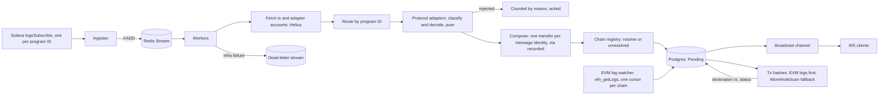

# hermit

A real-time indexer for bridge transactions on Solana. It decodes bridge
activity straight from Solana data, in both directions (sends out of Solana,
redeems and solver fills into it). Each transfer is persisted from on-chain
data alone, enriched afterwards with its counterpart leg and final status from
watched EVM logs, falling back to protocol APIs, and streamed live to clients
over WebSocket.

The product is moving from a Wormhole transfer indexer to a protocol-agnostic
core with one adapter per bridge protocol. Today only the Wormhole Token Bridge
is decoded.

Full details (implementation notes, read path, reliability, config, metrics,
roadmap, benchmarks): [docs/REFERENCE.md](docs/REFERENCE.md).

## Status

| Area | State |
| --- | --- |
| Wormhole Token Bridge | Outbound sends indexed chain-first and start `Pending` (Solana data alone; EVM logs and WormholeScan enrich). Inbound redeems decoded from the posted VAA account and stored as `Completed` |
| EVM logs | Ethereum Core Bridge `LogMessagePublished` and Token Bridge `TransferRedeemed` watched with a persisted cursor; fills source and destination tx hashes without WormholeScan |
| Detection | Chain-first for Wormhole transfers. WormholeScan never gates persistence for decoded transfers |
| Domain model | Generalised: `bridge_transfers` keyed by `(protocol, message_key)`, with `direction`, `via`, raw + resolved chains, `NUMERIC(78,0)` amounts. Wormhole fields in `wormhole_messages` |
| Chains | DB-backed registry, refreshed every `CHAIN_REGISTRY_REFRESH_SECS`. Unknown chains stored as unresolved |
| Enrichment | `EnrichmentProvider` trait; background worker re-enriches open rows and backfills missing inbound origin txs |
| Ingestion | Always on, supervised. Reconnect rewind, watchdog, concurrent backfill, periodic reconciliation poll |
| Read path | `/analyse` with memory cache, Postgres, single-flight, stale-while-revalidate |
| CI | `fmt --check`, `clippy -D warnings`, `cargo test` on every PR and `main` |
| Deploy | Two systemd units (`bridge-api`, `bridge-stream`) on EC2, Postgres on RDS, Caddy for TLS |

## Principles

1. **The chain is the source of truth.** Detection and decoding come from Solana
   data (Helius), never from an explorer. WormholeScan and other protocol APIs
   are enrichment only, and are cross-checked against the on-chain message.
2. **Protocol-agnostic core, per-protocol adapters.** Each adapter declares its
   program IDs, and classifies/decodes a Solana tx into a bridge event or
   rejects it with a reason.
3. **Composition is real.** One transfer can carry an outer protocol and an
   underlying rail. It is indexed once, the router is recorded as `via`.
4. **Direction matters.** Solana-outbound and Solana-inbound are both indexed.
5. **Unknown is not an error.** An unrecognised chain ID is stored as
   `unresolved(protocol, id)`, never dropped.

### Protocol coverage

| Protocol | State |
| --- | --- |
| Wormhole Token Bridge | Sends and redeems indexed |
| Wormhole NTT and other Wormhole programs | Phase A (A4) |
| Mayan, CCTP, LayerZero/Stargate, deBridge, Allbridge, Hyperlane, CCIP, Across | Candidates, ordered by DefiLlama Solana bridge volume |

## Architecture



Enrichment runs after the transfer is stored; a failed or empty enrichment
never blocks persistence. Redis Streams (consumer groups + `XAUTOCLAIM`) give
at-least-once delivery without a second infrastructure dependency; Postgres
upserts make persistence idempotent.

## Project structure

```text
hermit/
├── .github/workflows/ci.yml
├── deploy/Caddyfile            # TLS reverse proxy
├── migrations/                 # sqlx migrations, embedded at compile time
├── docs/                       # REFERENCE.md and per-experiment notes
├── scripts/                    # bench_list.sh, capture_fixtures.sh, capture_evm_fixtures.sh, probe_evm_*.sh
├── src/
│   ├── main.rs, lib.rs, config.rs, state.rs, error.rs, shutdown.rs
│   ├── bin/                    # replay, reconcile, seed_transfers
│   ├── domain/                 # types only, no IO
│   ├── vaa/                    # pure VAA decoding
│   ├── normaliser/             # provider JSON -> domain (pure)
│   ├── clients/                # Helius, WormholeScan, rate limiter
│   ├── chain_adapters/         # token symbol/decimals per chain
│   ├── protocols/              # BridgeAdapter, registry, compose, Wormhole adapter
│   ├── chains/                 # DB-backed chain registry
│   ├── enrichment/             # providers + background re-enrichment
│   ├── evm/                    # Ethereum log watcher, cursor, tx-hash lookup
│   ├── ingestion/              # WS listener, backfill, checkpoint gate
│   ├── redis/                  # producer, consumer group, recovery
│   ├── services/               # analyser, detect, read-through, reconcile, transfers
│   ├── db/
│   ├── handler/                # HTTP and WS handlers
│   └── routes/                 # v1, v2
├── tests/                      # unit, fixture, golden, Postgres-backed tests
└── Cargo.toml, docker-compose.yml, dockerfile
```

The full annotated tree is in [docs/REFERENCE.md](docs/REFERENCE.md#project-structure-full).

## API

```
GET /api/v1/transactions/analyse?transaction_hash=<hash>&chain=solana
GET /api/v2/transactions/analyse?transaction_hash=<hash>&chain=solana
GET /api/v2/transfers          # keyset-paginated list, filters
GET /api/v2/transfers/live     # server-owned recent-frames ring (Redis)
WS  /api/v1/transactions/stream
GET /health
```

`chain` is the source chain; Solana is the only supported source today.
Errors, list parameters and live-feed behaviour: see the
[reference](docs/REFERENCE.md#api-details). CORS is origin-allowlisted via
`ALLOWED_ORIGINS`; nothing is permitted by default.

## Running locally

Requires Postgres 18 and Redis.

```bash
cp .env.example .env   # fill in RPC URLs and the bridge program address
cargo run
```

Migrations run on startup. Other tools:

```bash
cargo run --bin replay -- --limit 200                              # compare status with WormholeScan
cargo run --bin reconcile -- --window-hours 2 --precision-sample 20  # stream recall and precision
```

HTTPS with Caddy, metrics, health and every config variable:
[reference](docs/REFERENCE.md#operations).

## LaserStream (experimental)

The live feed can optionally come from Helius LaserStream (gRPC) instead of
`logsSubscribe`. It is off by default: the default build and dependency graph
are unchanged, and `logsSubscribe` remains the production path.

The key is read only from `HELIUS_API_KEY` (never commit it):

```bash
# Connectivity probe: pings the endpoint, prints 20 confirmed slots, exits.
HELIUS_API_KEY=... cargo run --features laserstream --example laserstream_probe

# Run the indexer on LaserStream for one program.
INGEST_SOURCE=laserstream HELIUS_API_KEY=... cargo run --features laserstream
```

`INGEST_SOURCE=logs` (the default) keeps the WebSocket source. When
`laserstream` is selected, `LASERSTREAM_ENDPOINT` overrides the endpoint
(default `https://laserstream-devnet-ewr.helius-rpc.com`). Both sources publish
the same transaction candidates to the same Redis stream, so the consumer,
decode, persistence and read paths are identical. LaserStream does not run the
backfill yet; use `logs` for gaps.

## Testing

```bash
cargo test
```

Pure decode and adapter tests need no network or Docker. Postgres-backed tests
(`persistence_idempotency`, `list_transfers`, `bridge_transfers_schema`,
`chain_registry_db`) use testcontainers and need Docker, or set
`TEST_DATABASE_URL`. Capture new fixtures with `scripts/capture_fixtures.sh`.
Per-file coverage: [reference](docs/REFERENCE.md#testing-detail).

## Roadmap at a glance

| Phase | Goal | State |
| --- | --- | --- |
| 0 | Foundation: CI, decode tests, fixtures | Done except tagging `v0` |
| 1 / A | Protocol-agnostic core, Wormhole only (A1 to A10) | Done except A4 (all Wormhole programs) and A6 (composition end-to-end test) |
| 1 (rest) | Replay tool, decode bench | 1f criterion bench open |
| 2 | Deploy pipeline and roles | Roles, health, Caddy done. CD, hostnames, hardening, metrics dashboards open |
| 3 | Scale the API | 3b, 3c, 3e, 3f, 3g, perf-1, perf-2 done. 3a, 3d open |
| 4 | WebSocket stream recall/precision | 4a to 4g done |
| B+ | One protocol per phase | Not started |
| E | EVM coverage (separate checklist) | E0 done; E1 to E3 open |

Each checkpoint: branch, tests/fixtures, benchmark, Results row, PR, tag, deploy,
re-run on EC2. The full checklist is in the [reference](docs/REFERENCE.md#roadmap);
EVM coverage is in [Phase E](docs/REFERENCE.md#phase-e-evm-coverage-separate-checklist).

## Headline numbers

`R-hit` (warm cache, 769 signatures, 50 connections), `m7i-flex.large` server,
`c7i.xlarge` generator:

| Version | Change | req/s | p99 |
| --- | --- | ---: | ---: |
| v0 | baseline (generator-bound) | 36.5k | ~33 ms |
| 4ffb783 | re-baseline | 77.3k | ~1.05 ms |
| 03bbb0d (3b) | pre-serialized v1 body | 132.1k | ~0.59 ms |
| perf-1 | mimalloc | 139.3k | ~0.57 ms |
| perf-2 | single-`Arc` AppState | 156.8k | ~0.50 ms |

Stream (24 h, clean window): recall 100% (389/389), lag p99 2 s, precision 20/20.
List endpoint (3g): 1.2k to 1.6k req/s, p99 under 100 ms on all workloads.
Methodology and every run: [reference](docs/REFERENCE.md#benchmarks).

## Out of scope

Ingesting bridge transactions that happen only on other chains. Other chains
appear as counterparties through the chain registry and enrichment providers,
never as ingestion targets.
