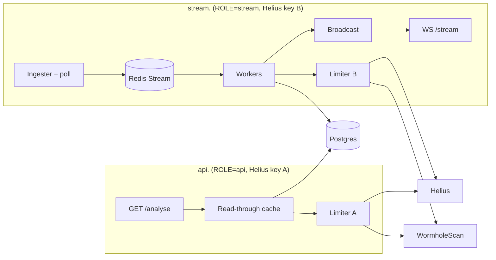
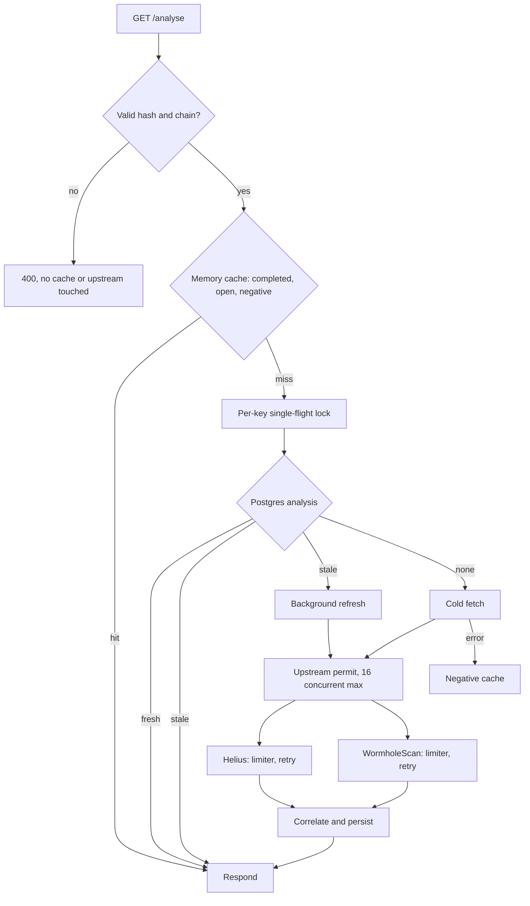

# hermit reference

Detailed notes moved out of the README. Start with [README.md](../README.md).

Contents: [Domain model](#domain-model-and-implementation-notes) · [Project structure](#project-structure-full) · [Read path](#read-path) · [Reliability](#reliability-properties) · [Known limitations](#known-limitations) · [API details](#api-details) · [Operations](#operations) · [Testing detail](#testing-detail) · [Roadmap](#roadmap) · [Benchmarks](#benchmarks)

***

## Domain model and implementation notes

### Target model

* A transfer carries `protocol`, an optional `via` (outer router), `direction`,
  source and destination chain references, a protocol-specific message identity
  (Wormhole emitter/sequence, CCTP domain/nonce, LayerZero GUID, deBridge order
  ID, ...) with a unique key per protocol, wallets, token, amount and a status:
  `Detected`, `Pending`, `Completed`, plus `Failed`/`Refunded` where a protocol
  needs them.
* Storage is split into a protocol-agnostic `bridge_transfers` table and one
  detail table per protocol (`wormhole_messages` today). Identity is
  `UNIQUE (protocol, message_key)`. `observed_tx_hash` is the Solana tx it was
  decoded from and `event_index` its position there, so one tx can hold several
  transfers.
* Chains live in a DB-backed registry: a canonical `chains` table plus a
  `(protocol, protocol_chain_id) -> chain` mapping table, because every protocol
  numbers chains differently (Wormhole chain IDs, CCTP domains, LayerZero
  endpoint IDs, EVM chain IDs, deBridge IDs). Unknown IDs are persisted as
  `unresolved(protocol, id)`.
* Later upgrade, designed now and built later: an unresolved ID can be looked up
  with a free LLM API. The answer is a proposal, never a fact. It enters the
  registry as `pending_review` and activates automatically only when it can be
  cross-checked against an authoritative source (Wormhole chain list, Circle's
  CCTP domain list, LayerZero endpoint metadata). Lookups are rate-limited and
  cached, one per unresolved `(protocol, id)`, with a negative cache.

### Implemented so far

* `MessageId` is an enum with one variant per protocol (only `Wormhole` today).
  `MessageId::key()` is the canonical string stored as `bridge_transfers.message_key`.
* `BridgeAdapter` is pure: `classify(&SolanaTx)` returns either the transfers it
  contains or a `Reject` of kind `not_transfer`, `unsupported` or `malformed`, with
  a reason. `ProtocolRegistry` routes a tx to every adapter whose program appears
  top-level **or in an inner instruction**, and `compose()` merges them into one
  transfer with `via` recorded.
* Amounts are `RawAmount`, a decimal string validated for `NUMERIC(78,0)` (fits a `u256`).
* Adapters emit a `RawChainRef` in the protocol's own namespace. `chains::Snapshot`
  resolves it to a canonical chain, or to `ChainRef::Unresolved`, never an error.
  Only `active` rows resolve, in both tables, and a mapping must point at an
  active chain, so a `pending_review` proposal can never label a real transfer.
* The migration seeds the 10 current chains plus the `wormhole` namespace (checked
  against `sdk/vaa/structs.go` in wormhole-foundation/wormhole) and the `evm`
  namespace (checked against ethereum-lists/chains). Each mapping row carries
  `status`, `origin` (`seed`, `manual`, `llm`), `evidence` and `verified_at`.
* `protocols::wormhole::WormholeAdapter` decodes Token Bridge outbound transfers
  (`transfer_native`, `transfer_wrapped` and the with-payload variants) from the tx
  alone. The Token Bridge CPIs the core bridge `PostMessage`: its instruction data
  carries the payload (amount, token, recipient, destination chain), its emitter
  account and the `Sequence: N` log give the message identity. A tx with
  `meta.err` set, a log/instruction mismatch or a bad payload is rejected with a
  reason, never guessed. The amount is the VAA amount (at most 8 decimals).
  Program IDs are from Wormhole's contract address reference, instruction indexes
  and layouts from `solana/modules/token_bridge` and `solana/bridge`.
* **Inbound redeems (A1b).** `complete_native`, `complete_wrapped` and the
  with-payload variants carry no instruction data: the message they redeem is the
  posted VAA account (third account of the instruction, owned by the core bridge).
  Adapters declare needed accounts (`BridgeAdapter::required_accounts`, default
  none), `analyse_tx` reads them with one `getMultipleAccounts` call through the
  Helius limiter into `SolanaTx::accounts`, and the adapter decodes identity and
  transfer with the in-house parser `protocols/wormhole/posted_vaa.rs`. It checks
  the account is owned by the core bridge and the payload is a transfer addressed
  to Solana. A redeem without its account loaded is `Unsupported`, any other
  mismatch is `Malformed`. A redeem decodes to the same `(protocol, message_key)`
  as the send it redeems, with `direction = Inbound` and no source wallet.
* **Inbound rows (A7).** A redeem's Solana tx is the destination side, so the
  stored row has `direction = 'Inbound'`, `observed_tx_hash` and
  `destination_tx_hash` both the redeem signature, `source_tx_hash` NULL and
  status `Completed` straight away (adapters reject failed txs). The origin tx is
  filled by enrichment: when WormholeScan's operation matches the on-chain
  message, its `sourceChain.transaction.txHash` becomes `source_tx_hash`, and a
  later analysis that could not reach WormholeScan never erases it.
  `/operations` is keyed by a signature, which for a redeem is the destination
  side, so its response can be empty or carry no source tx. The fallback is the
  message-key record `/api/v1/vaas/{emitterChain}/{emitterAddress}/{sequence}`,
  whose `data.txHash` is the origin tx. EVM hashes arrive as bare hex and get the
  `0x` prefix from the chain registry. The fallback fills only a missing
  `source_tx_hash` and its explorer URL, never the status or a set field. A
  completed inbound row still without an origin tx is revisited by
  `enrichment::reenrich`. One row per `(protocol, message_key)`, so a redeem is
  never stored twice. `BridgeTransfer::direction()` derives direction
  (destination Solana, source not Solana). In the frozen `/api/v1` response
  `source_tx_hash` is nullable, null only for a redeem whose origin tx is not
  known yet. A redeem that still goes through the WormholeScan-driven path is
  turned around the same way (`detect::as_inbound_observation`).
* **Wormhole NFT Bridge (opt-in).** `protocols/wormhole/nft_bridge.rs` implements
  the same `BridgeAdapter` for the NFT Bridge program
  `WnFt12ZrnzZrFZkt2xsNsaNWoQribnuQ5B5FrDbwDhD`, verified against
  `sdk/js/src/utils/consts.ts` (`MAINNET.solana.nft_bridge`),
  `solana/modules/nft_bridge/program/src/lib.rs` (instruction order) and
  `whitepapers/0006_nft_bridge.md` plus `messages.rs` (payload). The instruction
  indexes are `initialize=0`, `complete_native=1`, `complete_wrapped=2`,
  `complete_wrapped_meta=3`, `transfer_wrapped=4`, `transfer_native=5`,
  `register_chain=6`, `upgrade_contract=7`. Sends (`4`, `5`) are outbound
  `Pending`, paced against the core `PostMessage` CPI exactly as the Token
  Bridge adapter pairs them (same parent, later execution, core emitter account
  among the instruction's accounts, k-th `Sequence:` log for the k-th
  `PostMessage`). Completions (`1`, `2`) are inbound `Completed`, decoded from
  the posted VAA account at index 2 (preloaded, core-bridge owned); without it
  the redeem is `Unsupported`. `initialize`, `register_chain` and
  `upgrade_contract` are rejected `not_transfer` ("nft bridge admin
  instruction"), and `complete_wrapped_meta` is rejected `not_transfer` too —
  it only attaches SPL metadata to an already redeemed NFT, it does not move
  one. The transfer payload is payload ID `1`: token address (32), token chain
  (u16 BE), symbol (32, NUL-padded), name (32), token id (32), URI length (u8),
  URI, recipient (32), recipient chain (u16 BE). Representation on
  `BridgeTransfer`: `amount = 1` (one NFT is one unit; the payload has no
  amount), `token_symbol` is the payload's symbol (chain data, so it wins over
  token metadata), and `token` is the mint for a Solana-origin NFT
  (`token_chain == 1`, `token_id` is the mint) and otherwise the
  collection/contract on the origin chain (`token_chain`, `token_address`).
  Name, URI and raw `token_id` are not persisted: no column, and no new table.
  Rows use the existing `MessageId::Wormhole` key, so an NFT message never
  collides with a Token Bridge one. The program ID is opt-in: the adapter is
  registered only when `SOLANA_NFT_BRIDGE_PROGRAM` is set, and that program is
  never also registered to the Token Bridge adapter, so an unset variable keeps
  an existing deployment exact (same subscriptions, same registry, same rows).
* **Circle CCTP V2 on Solana (opt-in).** `protocols/cctp/mod.rs` implements the
  same `BridgeAdapter` for Circle's V2 programs:

  | Program | ID | Verified against |
  | --- | --- | --- |
  | MessageTransmitterV2 | `CCTPV2Sm4AdWt5296sk4P66VBZ7bEhcARwFaaS9YPbeC` | <https://developers.circle.com/cctp/references/solana-programs> |
  | TokenMessengerMinterV2 | `CCTPV2vPZJS2u2BBsUoscuikbYjnpFmbFsvVuJdgUMQe` | <https://developers.circle.com/cctp/references/solana-programs> |

  Instruction discriminators are Anchor's `sha256("global:<name>")[..8]`, checked
  against the published `initialize` value `afaf6d1f0d989bed`:
  `deposit_for_burn = d73c3d2e723780b0`,
  `deposit_for_burn_with_hook = 6ff53e83cc6cdf9b`,
  `receive_message = 26907fe11fe1ee19`,
  `send_message = 392822b2bd0a411a`,
  `handle_receive_finalized_message = bafcef4656b46e5f`,
  `handle_receive_unfinalized_message = c8a9af14c83ab63d`.
  Message and burn-body layouts are from `message.rs` and `burn_message.rs` in
  <https://github.com/circlefin/solana-cctp-contracts>.

  **Identity.** `MessageId::Cctp { source_domain, nonce }`, key
  `<source_domain>/<nonce>`, where the nonce is the 32-byte value from the
  attested message (lowercase hex). The V2 header is 148 bytes: version `u32`
  BE at 0, source domain at 4, destination domain at 8, nonce at 12..44, sender
  and recipient programs next. The burn body is 228 bytes: version at 148,
  burn token at 152..184, mint recipient at 184..216, amount (`u256` BE, the
  Solana side reads its low 8 bytes) at 216..248, message sender at 248..280.
  Only version `1` is decoded; version `0` is rejected `unsupported`
  ("cctp v1 message").

  **Only inbound completions are indexed.** `receive_message` carries
  `{ message: Vec<u8>, attestation: Vec<u8> }` (Borsh, with 4-byte LE length
  prefixes) and is decoded from the attested message itself, so the nonce is
  canonical. A Solana send (`deposit_for_burn`,
  `deposit_for_burn_with_hook`) writes an all-zero nonce placeholder; Circle
  assigns the real nonce off-chain. Without Iris there is no chain-derived
  message identity for a send, so it is rejected
  `unsupported` ("cctp send: nonce is assigned offchain") and **not stored**.
  Indexing outbound sends needs a follow-up that resolves the nonce through
  Circle's Iris API (or reads a later message that carries it); the event
  account pubkey must never be used as a nonce. Admin and utility instructions
  (for example `reclaim_event_account`, `update_attester_manager`,
  `set_min_fee`) are rejected `not_transfer` ("cctp admin instruction").

  **Domains seeded** by `20261115120000_cctp_messages.sql`, checked against
  <https://developers.circle.com/cctp/concepts/supported-chains-and-domains>:

  | Domain | Chain |
  | --- | --- |
  | 0 | Ethereum |
  | 1 | Avalanche |
  | 3 | Arbitrum |
  | 5 | Solana |
  | 6 | Base |

  Any other domain is stored as an unresolved `cctp` reference, never an
  error. The origin sender and token are decoded only for Solana (base58) and
  the seeded EVM domains (`0x` + the last 20 bytes); an unseeded origin keeps
  the raw reference and leaves the wallet/token absent. CCTP has no `/api/v1`
  representation (v1 is frozen to the Wormhole Token Bridge); `/api/v2`
  returns `message_id: { protocol: "cctp", source_domain, nonce }`.

  **Config.** Both `SOLANA_CCTP_MESSAGE_TRANSMITTER_PROGRAM` and
  `SOLANA_CCTP_TOKEN_MESSENGER_MINTER_PROGRAM` are required together: setting
  one without the other is a startup error, and setting neither leaves the
  adapter off. When set, both IDs are registered to the CCTP adapter and
  removed from the Wormhole adapter's program set, so no transaction is
  classified twice and an unset deployment sees exactly the old behaviour.
* **Migrations** (none has a down migration: snapshot the database before deploying):
  * `20261018120000_generalise_bridge_transfers.sql` (A2) rewrites existing rows
    in place: every legacy row becomes `protocol = 'wormhole'`,
    `direction = 'Outbound'`, with the same message key `MessageId::key()` builds.
    Chains are stored as raw reference (`*_ref_protocol`, `*_ref_id`) plus
    `*_chain_id`, which `resolve_chain()` fills when known. Unknown IDs stay
    unresolved and a partial index finds them when a mapping is activated. An
    amount that is not a plain integer becomes NULL (the full value stays in `analysis`).
  * `20261024120000_repair_inbound_rows.sql` (A7): a message emitted by any chain
    other than Solana and observed on Solana becomes `Inbound` with the redeem as
    destination tx and `Completed`; its cached analysis is dropped.
  * `20261030120000_repair_inbound_source_wallet.sql` clears `source_wallet` on
    `Inbound` rows written by the old WormholeScan fallback (which stored the
    redeem tx's Solana signer). Outbound rows and already-NULL rows are untouched;
    a second run matches nothing.
  * `20261110120000_evm_log_watching.sql` adds `evm_watch_targets` (per-chain
    Core Bridge and Token Bridge addresses and finality depth, seeded with
    Ethereum and its Wormhole chain ID 2), `evm_watch_cursors` and
    `evm_log_events`.
  * `20261111120000_evm_watch_target_chain_id.sql` adds
    `evm_watch_targets.evm_chain_id` (the `eth_chainId` the endpoint must answer
    with, checked at watcher startup) and sets Ethereum to 1.
  * `20261112120000_evm_watch_target_finality_mode.sql` adds
    `evm_watch_targets.finality_mode` (`finalized` or `depth`, DB-checked,
    default `finalized`), so each chain chooses its finality rule. Existing
    rows, including Ethereum, keep `finalized`.
  * `20261113120000_enable_base_arbitrum_avalanche.sql` seeds
    `evm_watch_targets` for Base, Arbitrum and Avalanche with the verified Core
    and Token Bridge addresses, `evm_chain_id`, `finality_mode = 'finalized'`
    and fallback depths 6500, 5000 and 32.
  * `20261114120000_bridge_transfer_program.sql` adds
    `bridge_transfers.program` (`TEXT NOT NULL DEFAULT 'token_bridge'`) and
    backfills every existing row to `token_bridge`. The column records which
    protocol sub-program decoded the transfer; `/api/v1` only serves
    `token_bridge` rows and `/api/v2` exposes the field additively.
  * `20261115120000_cctp_messages.sql` adds `cctp_messages` (`transfer_id` PK,
    `source_domain`, `nonce`, message `version`, unique on
    `(source_domain, nonce)`) and seeds CCTP domains 0, 1, 3, 5 and 6.
* **Per-program Solana ingestion (A4, ingestion plumbing).** The configured set
  is `SOLANA_BRIDGE_PROGRAMS` (`protocol:program_id` CSV), or the single
  `SOLANA_TOKEN_BRIDGE_PROGRAM` when the list is unset. A second, separately
  configured Wormhole program can be added with `SOLANA_NFT_BRIDGE_PROGRAM`:
  when set it is registered to the NFT Bridge adapter and subscribed like any
  other program, and when unset the NFT Bridge is not subscribed to at all.
  Every entry gets its own
  `logsSubscribe` (`mentions` takes one address), checkpoint
  (`solana:<program>_last_ingested_slot`), backfill, reconnect/watchdog loop and
  reconciliation-poll stream. A rejected subscription, a dead connection or a
  panic is restarted for that program only, so one program never stops the
  others. On startup `solana_last_ingested_slot` is copied once to the Token
  Bridge's per-program key (value and `updated_at`, `ON CONFLICT DO NOTHING`), so
  a single-program deployment resumes exactly where it stopped without a gap or
  a replay. `/health` reads only the Token Bridge checkpoint: the service counts
  as advancing when the Token Bridge advances, never because another configured
  program is.
* **EVM log watching (Ethereum, Base, Arbitrum and Avalanche).** One watcher per enabled
  `evm_watch_targets` row polls `eth_getLogs` over the configured address and
  topic filters and stores events keyed by
  the message identity `(emitter_chain, emitter_address, sequence)` plus tx hash,
  block number, block hash and block timestamp. The chain runs on
  `EVM_RPC_<CHAIN>` and an optional `EVM_RPC_<CHAIN>_FALLBACK`. Each endpoint has
  its own limiter and its own live `eth_getLogs` window: a 429, timeout or 5xx
  moves the watcher to the next endpoint, and a range-too-large answer halves only
  the window of the endpoint that rejected it. A failed chunk stores nothing and
  leaves the cursor alone. The watcher calls `eth_chainId` once at startup and
  drops an endpoint that serves another chain. `LogMessagePublished` on the Core
  Bridge is kept only when the indexed sender is the Token Bridge, and its tx
  hash is the source tx. `TransferRedeemed` on the Token Bridge names the
  original message (`emitterChainId`, `emitterAddress`, `sequence`) and its tx
  hash is the destination tx. Topics are `keccak256` of the ABI signatures, and
  a test recomputes both. Each target's `finality_mode` decides what counts as
  final: `finalized` reads the node's `finalized` tag and falls back to
  `head - finality_depth` only when the provider rejects it, while `depth`
  always reads `head - finality_depth` and never asks for the tag. Each row is
  parsed and validated before its watcher is spawned: a row with an unknown
  `finality_mode`, a negative `finality_depth` (or zero in `depth` mode), a
  non-`u16` Wormhole chain id, a negative `evm_chain_id`, or a bridge address
  that is not 20-byte hex is skipped and logged with the chain and the reason.
  The other chains still start, and only a failure to read the rows turns EVM
  watching off. If every row is invalid, no watcher starts and startup logs an
  error.
  The watcher advances a persisted cursor per chain in the same transaction that
  stores a range's events. On a cursor-hash mismatch it walks the stored block
  hashes of event-bearing blocks from the cursor down to the rewind bound
  (`finality_depth` in `depth` mode, 128 blocks in `finalized` mode) and looks
  for the newest checkpoint whose hash still matches the chain. A matching
  checkpoint proves the fork is above it, so the cursor rewinds to that block
  and every event above it is deleted in one transaction. Rewinding to the
  matching checkpoint, rather than to the lowest stale event block, re-reads the
  whole region the reorg may have changed, including blocks between the real
  fork and the stale block that never stored a hash. If no stored checkpoint
  inside the bound still matches, the window floor is the conservative rewind
  point (when the window holds no stored checkpoint at all, only the cursor
  block itself is known stale, so only it is re-read); if the floor itself is
  stale, the reorg is deeper than the bound, the poll fails, and the cursor and
  stored events are left untouched rather than advancing past canonical events.
  A rewind logs a warning and increments `evm_reorgs_total` with the chain and
  endpoint host. A join that an orphaned event already applied is not rolled
  back: `source_tx_hash`, `destination_tx_hash` and a `Completed` status written
  from it stay on the `bridge_transfers` row (the join's `COALESCE` keeps an
  existing hash, so a later canonical event does not overwrite it). Ingest is
  idempotent on
  `UNIQUE (chain_id, tx_hash, log_index)`. The event-side join fills
  `source_tx_hash` (inbound) or `destination_tx_hash` + `Completed` (outbound);
  a transfer-side lookup fills the same fields before enrichment falls back to
  WormholeScan, with no age limit, so an event recorded before the row was built
  still matches. WormholeScan stays the fallback for pre-watcher events, unwatched
  destinations and missing metadata.

  The migrations seed Ethereum (Wormhole 2 / EVM 1), Base (30 / 8453),
  Arbitrum (23 / 42161) and Avalanche (6 / 43114). Base and Arbitrum use dRPC
  as primary and Alchemy as fallback; Avalanche uses the keyless
  `api.avax.network` endpoint as primary and Alchemy as fallback. The measured
  per-endpoint ranges are 101 for dRPC, 10 for Alchemy and 100 for the Avalanche
  public endpoint.

  An endpoint is measured before its chain is enabled. `scripts/probe_evm_range.sh
  <chain>` doubles the `eth_getLogs` block range until the endpoint rejects it and
  binary-searches the boundary; `scripts/probe_evm_finality.sh <chain>` reports the
  `latest`, `safe` and `finalized` block numbers and lag. Both read
  `EVM_RPC_<CHAIN>` (or `EVM_RPC_<CHAIN>_FALLBACK` with `--fallback`), print only
  the endpoint host so a key in the URL is not leaked, and write nothing to the
  repository. Record the results in `docs/scaling-log.md`.
* `services::detect` turns adapter output into the API's `BridgeTransfer`: an
  outbound send starts `Pending`, an inbound redeem (decoded from the posted
  VAA) starts `Completed`. `apply_wormholescan` then raises the status: `Pending`
  when a matching VAA exists, `Completed` when the destination tx is known; a
  failed or mismatched enrichment leaves the chain-derived status alone. Token
  symbol and decimals are a best-effort lookup with a 2 s timeout. The upsert
  never moves a status backwards, and the cached analysis follows the same rule.

### Architecture after Phase 2

Helius rate limits are per key, so the user-facing read path and the ingestion
pipeline must not share one. The same binary runs in two roles with separate
Helius keys, limiters and hostnames. `ROLE=all` stays for local dev.



### Why Redis Streams, not Kafka

Consumer groups plus `XAUTOCLAIM` give at-least-once delivery, per-worker ack
tracking and automatic redelivery of stuck messages without a second
infrastructure dependency. Kafka is the right call at higher throughput or with
multiple independent consumer applications; for a single-service pipeline at
this scale it is added operational cost for guarantees Redis Streams already provides.

***

## Project structure (full)

Entries marked *(planned)* arrive with Phase A and later.

```text
hermit/
├── .github/
│   └── workflows/
│       └── ci.yml                      # fmt, clippy, test (Phase 0)
├── .sqlx/                              # offline query data
├── deploy/
│   └── Caddyfile                       # host-installed TLS reverse proxy in front of the API
├── migrations/
│   ├── 20260912071405_create_bridge_transfers.sql
│   ├── 20260912162718_create_indexer_state.sql
│   ├── 20260912232059_fix_indexer_state_key_name.sql
│   ├── 20261002150000_analysis_and_read_indexes.sql
│   ├── 20261017090000_chain_registry.sql
│   ├── 20261018120000_generalise_bridge_transfers.sql
│   ├── 20261024120000_repair_inbound_rows.sql
│   ├── 20261030120000_repair_inbound_source_wallet.sql
│   ├── 20261030130000_index_missing_origin.sql
│   ├── 20261030140000_origin_attempt_marker.sql
│   ├── 20261031120000_list_endpoint_token_index.sql
│   ├── 20261110120000_evm_log_watching.sql
│   ├── 20261111120000_evm_watch_target_chain_id.sql
│   ├── 20261112120000_evm_watch_target_finality_mode.sql
│   ├── 20261113120000_enable_base_arbitrum_avalanche.sql
│   └── 20261114120000_bridge_transfer_program.sql
├── docs/
│   ├── REFERENCE.md                     # this file
│   ├── 3e-worker-patience.md
│   ├── 4bd-reconnect-verification.md
│   ├── 4c-concurrent-backfill.md
│   ├── 4f-reconcile-poll.md
│   ├── 3g-list-endpoint.md
│   └── scaling-log.md
├── scripts/
│   ├── bench_list.sh
│   ├── capture_evm_fixtures.sh         # eth_getLogs for the watched topics
│   ├── capture_fixtures.sh
│   ├── probe_evm_finality.sh           # latest/safe/finalized lag per endpoint
│   └── probe_evm_range.sh              # max eth_getLogs block range per endpoint
├── src/
│   ├── main.rs                         # wiring, supervised workers, HTTP server
│   ├── lib.rs
│   ├── config.rs
│   ├── state.rs                        # AppState, limiters, caches
│   ├── error.rs                        # AppError -> HTTP responses
│   ├── shutdown.rs
│   ├── bin/
│   │   ├── replay.rs                   # last N signatures vs WormholeScan (1e)
│   │   ├── reconcile.rs                # stream recall vs getSignaturesForAddress (4a)
│   │   └── seed_transfers.rs           # 1M throwaway rows for list benchmarks (3g)
│   ├── domain/                         # types only, no IO
│   │   ├── bridge.rs
│   │   ├── bridge_transfer.rs
│   │   └── transaction.rs
│   ├── vaa/decode.rs                   # VAA, address and amount decoding (pure)
│   ├── normaliser/                     # raw provider JSON -> domain (pure)
│   │   ├── solana.rs
│   │   └── wormhole.rs
│   ├── clients/
│   │   ├── helius.rs                   # getTransaction, getMultipleAccounts, getSignaturesForAddress
│   │   ├── wormhole.rs
│   │   └── limiter.rs
│   ├── chain_adapters/                 # token symbol and decimals per chain
│   │   ├── mod.rs, registry.rs, setup.rs, solana.rs
│   ├── protocols/                      # protocol-agnostic core
│   │   ├── mod.rs                      # BridgeAdapter, Protocol, MessageId, Direction, DetectedTransfer, Reject
│   │   ├── registry.rs                 # program ID -> adapters, SOLANA_BRIDGE_PROGRAMS parser
│   │   ├── compose.rs
│   │   ├── solana_tx.rs                # pure SolanaTx view from Helius jsonParsed + preloaded accounts
│   │   ├── amount.rs                   # RawAmount
│   │   └── wormhole/
│   │       ├── mod.rs                  # Token Bridge adapter, outbound and inbound
│   │       ├── nft_bridge.rs           # NFT Bridge adapter, opt-in via SOLANA_NFT_BRIDGE_PROGRAM
│   │       └── posted_vaa.rs           # core bridge posted VAA account parser
│   ├── chains/
│   │   ├── mod.rs                      # RawChainRef, ChainRef, Snapshot, resolve
│   │   └── db.rs                       # load_snapshot
│   ├── enrichment/
│   │   ├── mod.rs                      # EnrichmentProvider trait
│   │   ├── wormholescan.rs             # /operations, /global-tx, /vaas fallback
│   │   ├── evm_first.rs                # EVM event lookup before WormholeScan
│   │   └── reenrich.rs                 # background pass
│   ├── evm/
│   │   ├── mod.rs
│   │   ├── client.rs                   # JSON-RPC, own limiter, range-halving
│   │   ├── db.rs                       # targets, cursor, events, joins
│   │   ├── decode.rs                   # LogMessagePublished, TransferRedeemed
│   │   ├── lookup.rs                   # transfer-side tx hash lookup
│   │   └── watcher.rs                  # poll loop, finality, reorgs
│   ├── ingestion/
│   │   ├── solana.rs
│   │   ├── backfill.rs                 # pure backfill planning
│   │   ├── checkpoint.rs               # per-connection gate (4c)
│   │   └── types.rs
│   ├── redis/
│   │   ├── producer.rs
│   │   └── consumer.rs
│   ├── services/
│   │   ├── analyzer.rs                 # analyse_tx
│   │   ├── correlator.rs
│   │   ├── token_metadata.rs
│   │   ├── detect.rs
│   │   ├── read_through.rs
│   │   ├── reconcile.rs
│   │   ├── reconcile_poll.rs
│   │   ├── replay.rs
│   │   └── transfers.rs
│   ├── db/
│   │   ├── connection.rs
│   │   └── repository.rs
│   ├── handler/
│   │   ├── analyse.rs
│   │   ├── stream.rs
│   │   └── transfers.rs
│   └── routes/
│       ├── mod.rs                      # router + CORS
│       ├── v1/{mod.rs, transactions.rs}
│       └── v2/{mod.rs, transactions.rs}
├── tests/
│   ├── bridge_transfers_schema.rs
│   ├── chain_registry_db.rs
│   ├── common/
│   ├── decode_unit.rs
│   ├── evm_log_watch.rs
│   ├── fixtures_decode.rs
│   ├── golden_fixtures.rs
│   ├── list_transfers.rs
│   ├── persistence_idempotency.rs
│   └── fixtures/                       # helius_<name>.json, wormhole_<name>.json, account_<name>_vaa.json
├── benches/                            # (planned) criterion, Phase 1
├── .env.example
├── .dockerignore
├── .gitignore
├── Cargo.toml
├── Cargo.lock
├── docker-compose.yml
├── dockerfile
└── README.md
```

***

## Read path

`GET /api/v1/transactions/analyse`. A cold analysis is expensive: Helius and
WormholeScan are called in parallel, the VAA is decoded, and the transfer is
correlated with its destination chain (about 360 ms median, and both providers
rate-limit). The read path exists so almost no request pays that cost.



| Layer | What it does |
| --- | --- |
| Hash validation | Rejects anything that isn't a 64-byte base58 Solana signature, and any source chain other than Solana, with a 400 before any cache or upstream call |
| Memory cache (moka) | `completed` 10 min, `open` (Pending/Detected) 15 s, `not_found` 30 s, transient upstream/normalisation failures 10 s (`FAILED_CACHE_TTL_SECS`) |
| Single-flight lock | One request per `(chain, tx hash)` does the work; concurrent requests wait, then re-check memory. 50 concurrent requests for one uncached hash cause 1 upstream fetch |
| Postgres | `bridge_transfers.analysis` holds the last analysis. Completed are always fresh; Pending/Detected fresh for 60 s |
| Stale-while-revalidate | A stale row is served immediately and refreshed in the background (max 8 at once, 15 s cooldown per key). A failed refresh only logs |
| Rate limiting | One `governor` limiter per provider. A call waits at most 2 s for a token, then fails fast with 503 |
| Retries | 429, timeout and 502 retry up to 3 times with exponential backoff and jitter, each attempt going back through the limiter |
| Concurrency cap | A semaphore bounds concurrent cold fetches (16); permit wait times out after 2 s with a 503 |

Steady-state upstream load is roughly `hot keys ÷ freshness window`. With the
60 s window, 769 hot Pending transfers need about 13 refreshes per second,
which must stay under the configured provider quotas.

### Tuning

| Setting | Where | Default |
| --- | --- | --- |
| Freshness window for non-Completed rows | `FRESH_SECS` in `services/read_through.rs` | 60 s |
| Failed-analysis negative cache TTL | `FAILED_CACHE_TTL_SECS` | 10 s |
| Max background refreshes | `MAX_BACKGROUND_REFRESHES` | 8 |
| Cache TTLs and capacities | `ReadThrough::new` | see table above |
| Provider quotas | `HELIUS_API_RPS`, `HELIUS_LIVE_RPS`, `wormhole_limiter` in `AppState::new` | Helius 6/s (API) + 4/s (ingest) to fit the free plan's 10/s while both lanes share one key, WormholeScan 20/s. With a key per lane (`HELIUS_API_URL`, `HELIUS_STREAM_URL`) raise each to its own plan's limit |

### Token metadata

Symbol and decimals come from one Helius `getAsset` per mint, cached per mint
(24h resolved, 60s failed or empty). A cache miss uses the shared Helius limiter
only if a token is free; otherwise the transfer is processed without metadata
and the miss is not cached, so a later request retries.

***

## Reliability properties

* **At-least-once processing, exactly-once persistence.** Redis Streams
  guarantees at-least-once delivery; Postgres upserts on `hash` and
  `(protocol, message_key)` absorb redelivery.
* **Dead-letter queue, for permanent failures.** A transaction that fails
  analysis or persistence and cannot fix itself (malformed data, normalisation
  failure, a provider answer that cannot change on retry such as invalid params)
  moves to `bridge:transactions:failed`.
* **Transient failures stay pending, bounded.** A rate limit, timeout, 5xx,
  limiter shed (`Overloaded`) or database outage neither acks nor dead-letters:
  the message stays pending and recovery redelivers it after its idle time.
  Every delivery is counted (`XPENDING` times-delivered), and past
  `WORKER_MAX_DELIVERIES` (default 10) it is dead-lettered with the reason.
* **Self-healing recovery.** A dedicated worker reclaims messages abandoned by a
  crashed consumer via `XAUTOCLAIM`, every `WORKER_RECLAIM_INTERVAL_SECS` (30)
  and after `WORKER_RECLAIM_IDLE_MS` (5 min), running the same handler as first delivery.
* **Graceful shutdown.** SIGTERM/Ctrl+C stops new work, lets in-flight messages
  finish, and drains open HTTP/WS connections.
* **Upstream protection on the read path.** Per-provider rate limiters, retries
  with backoff and jitter, a bounded concurrency semaphore, and fail-fast 503s
  with `Retry-After`.
* **Failures are cached too.** Not-found results (30 s) and transient upstream
  failures are remembered, so one bad hash can't make every request redo the
  full upstream attempt.
* **Stale data beats a slow answer.** Pending transfers past their freshness
  window are served from Postgres while a background task refreshes them.
* **Enrichment never gates persistence.** A transfer decoded from Solana data is
  stored even if WormholeScan is down (outbound as `Pending`, inbound as
  `Completed`), and a status never moves backwards.
* **Account preloads fail loud on the live path.** Adapter-requested accounts
  (the posted VAA of a redeem) are read in one `getMultipleAccounts` call through
  the Helius limiter. A live message whose preload fails transiently is left
  pending and retried, because a redeem without its VAA account is reported
  `Unsupported` and falls onto the WormholeScan path, which can store a row with
  the wrong source wallet (or dead-letter the redeem when WormholeScan is down).
  A permanent preload error, and every preload in the read-only `reconcile` tool,
  stays best effort.
* **Open transfers converge on their own.** A supervised worker re-enriches
  `Detected` and `Pending` rows every `REENRICH_INTERVAL_SECS`, oldest attempt
  first, through the WormholeScan limiter (never Helius). Rows younger than
  `REENRICH_MIN_AGE_SECS` are left to the normal pipeline, a row is not asked
  again within `REENRICH_RETRY_SECS`, and rows older than `REENRICH_MAX_AGE_SECS`
  are given up on. The same pass backfills the origin tx of `Completed` inbound
  rows whose `source_tx_hash` is NULL. `REENRICH_ORIGIN_SHARE` (40% default)
  reserves that share of each `REENRICH_BATCH`, so open rows cannot starve it;
  `REENRICH_MAX_AGE_SECS` does not apply to those. The backfill records
  `last_enrich_attempt_at` for every attempt and orders by it NULLS FIRST, so
  the queue rotates. A row whose cached `analysis` a repair migration dropped is
  rebuilt from stored columns first. When `/operations` is empty or carries no
  source tx, the pass falls back to the `/vaas` record (`data.txHash`) and
  normalises the hash per chain. A pass ends early after three provider outages in a row.
* **Helius token wait.** The API sheds a request after 2 s without a token
  (`Overloaded`, 503). Live workers wait up to `HELIUS_LIVE_TOKEN_WAIT_MS` (20 s)
  for the first token of a message, but `Overloaded` is transient, so the
  message stays pending and recovery redelivers it. The wait must stay well
  below the reclaim idle time (5 min).

***

## Known limitations

* **An orphaned join stays.** A hash or `Completed` status written from an event that a reorg later deletes is never cleared; a generous `finality_depth` is the mitigation.
* **Outbound NFT transfers never leave `Pending`.** The NFT side of a transfer on an EVM chain emits no event the watcher can join: the EVM watcher is Token Bridge and Core Bridge only, and an NFT destination tx is not confirmed by watching. WormholeScan's destination tx hash is still recorded as a hint, but the status deliberately stays `Pending` rather than advancing on an unverified hint. An inbound redeem on Solana is decoded from the posted VAA and is `Completed`.

***

## API details

| Status | Code | Meaning |
| --- | --- | --- |
| 200 | | Analysis returned (cache, Postgres, or fresh fetch) |
| 400 | `INVALID_TX_HASH`, `BAD_REQUEST` | Malformed hash or request |
| 404 | `TX_NOT_FOUND`, `VAA_NOT_AVAILABLE` | Tx doesn't exist, or its VAA isn't available yet. Cached briefly |
| 422 | `NORMALISATION_FAILED` | Data couldn't be normalised, including unsupported chains |
| 429 | `UPSTREAM_RATE_LIMITED` | Provider rate-limited after retries. `Retry-After: 1` |
| 502 / 504 | `UPSTREAM_ERROR`, `UPSTREAM_TIMEOUT` | Provider failed or timed out after retries |
| 503 | `OVERLOADED` | Limiter or permit wait exceeded 2 s. `Retry-After: 1` |
| 500 | `INTERNAL_ERROR` | Unexpected error |

### `/api/v1` and programs other than the Token Bridge

`/api/v1` keeps the frozen Wormhole Token Bridge shape. Every `bridge_transfers`
row records the sub-program that decoded it in `program` (`token_bridge`, or
`nft_bridge` for the NFT Bridge). The v1 compatibility mapper returns only a row
whose `program = 'token_bridge'`; a transaction whose transfers all come from
another program (for example `nft_bridge`) is rejected with
`422 NORMALISATION_FAILED`, never mapped as a Token Bridge transfer. `/api/v2`
carries `program` on every transfer, and the field is additive: v1 response
bodies are byte for byte unchanged.

### List transfers (`GET /api/v2/transfers`)

Lists stored transfers newest first, one page per request. `items` uses the same
transfer object as `/api/v2/transactions/analyse`. There is deliberately no
total count (it needs a full scan). Page until `next_cursor` is `null`.

```
GET /api/v2/transfers?limit=50&direction=Inbound&status=Completed&chain=ethereum
```

| Parameter | Meaning | Rules |
| --- | --- | --- |
| `limit` | page size | default 50, 1 to 200 |
| `cursor` | position from the previous `next_cursor` | opaque; strictly after the last returned row |
| `protocol` | exact stored protocol | non-empty |
| `direction` | `Outbound` or `Inbound` | case-sensitive |
| `status` | `Detected`, `Pending`, `Completed`, `Failed`, `Refunded` | |
| `chain` | canonical chain slug from `chains.slug` | matches source **or** destination |
| `token` | exact stored token address | no token-chain key |
| `from` | inclusive lower bound on `created_at` | RFC3339 |
| `to` | exclusive upper bound on `created_at` | RFC3339; must be after `from` |

Pagination is keyset over `(created_at DESC, id DESC)`: no `OFFSET`, and rows
with identical `created_at` are visited exactly once. The ordering key is the
time the indexer stored the row, not block time. `from`/`to` combine with the
cursor as additional bounds. Errors: 400 `BAD_REQUEST` (invalid limit, cursor,
timestamp; unknown chain, direction, status; `from >= to`), 500 `INTERNAL_ERROR`.
No cache on this path. Plans and the one added index:
[3g-list-endpoint.md](3g-list-endpoint.md).

The v2 transfer model still has one `message_id` shape (`wormhole`), so a page
containing a row for another protocol fails with `422 NORMALISATION_FAILED`
until that protocol gets a `MessageId` variant.

### Live feed (`GET /api/v2/transfers/live`)

A server-owned ring of the most recent WebSocket frames, so every browser sees
the same recent transactions. The indexer writes it; readers never touch Postgres.

```
GET /api/v2/transfers/live?limit=15&before=<next_cursor>
```

| Parameter | Meaning | Rules |
| --- | --- | --- |
| `limit` | page size | default 15, clamped 1..100 |
| `before` | position from the previous `next_cursor` | opaque; strictly older than the last returned item |

Response: `{ "items": [...], "next_cursor": string|null, "total": <ZCARD>, "server_time": <ms> }`.
Each item is the v1 WebSocket frame plus `first_seen_at` (ring position, never
changes on enrichment update) and `updated_at` (last write), in milliseconds.
Newest first; `total` is the current ring size.

Reads Redis only (`ZREVRANGEBYSCORE`, `HMGET`). If the ring is empty after a
cold start or Redis restart, one process takes `SET bridge:live:warmup 1 NX EX 30`
and fills it from the newest `LIVE_FEED_MAX` stored analyses; concurrent readers
get an empty page meanwhile. When Redis is down the endpoint serves the last
in-process cursorless page for up to 10 s, then `503` with an empty-feed body; a
circuit breaker admits one Redis probe per 5 s. Responses carry
`Cache-Control: public, s-maxage=2, stale-while-revalidate=10`.

Registered only when `LIVE_FEED_REDIS_ENABLED` is on. When off, the route does
not exist (404), the WebSocket payload is unchanged, and no Redis command is issued.

***

## Operations

### HTTPS with Caddy (host install)

`deploy/Caddyfile` puts a host-installed Caddy in front of the API: TLS, HTTP/2,
compression, proxy to `127.0.0.1:8080`, JSON access logs. No Docker.

```bash
sudo apt install -y debian-keyring debian-archive-keyring apt-transport-https curl
curl -1sLf 'https://dl.cloudsmith.io/public/caddy/stable/gpg.key' \
  | sudo gpg --dearmor -o /usr/share/keyrings/caddy-stable-archive-keyring.gpg
curl -1sLf 'https://dl.cloudsmith.io/public/caddy/stable/debian.deb.txt' \
  | sudo tee /etc/apt/sources.list.d/caddy-stable.list
sudo apt update && sudo apt install caddy
```

```bash
sudo cp deploy/Caddyfile /etc/caddy/Caddyfile
sudo sed -i 's/api\.example\.com/api.yourdomain.com/' /etc/caddy/Caddyfile
sudo caddy validate --config /etc/caddy/Caddyfile
sudo systemctl reload caddy
curl -fsS https://api.yourdomain.com/health
```

* Point a DNS `A` record at the box before reloading; Caddy needs it for the certificate.
* Security group: allow `80` and `443`, keep `8080` closed (the app binds `0.0.0.0`).
* WebSockets are proxied automatically.
* CORS stays in the app (`src/routes/mod.rs`). Do not add CORS headers in Caddy.

### Replay against WormholeScan

```bash
cargo run --bin replay -- --limit 200
```

Replays the last N Token Bridge signatures through the real pipeline and
compares status with WormholeScan's `global-tx`. Needs the server's env, reads
the chain registry from `DATABASE_URL`, writes nothing. Exits 1 when agreement
on transfers older than `--min-age-secs` (default 900) is below `--min-agreement`
(default 99). `cargo run` alone still starts the server (`default-run = "bridge"`).

### Reconcile

```bash
cargo run --bin reconcile -- --window-hours 2 --precision-sample 20
```

Measures the ingester's recall and the classifier's precision per registered
program over `--window-hours` (default 2), ending `--end-offset-secs` (default
600\) ago. Ground truth is `getSignaturesForAddress`: failed txs are dropped,
signatures already in `bridge_transfers` are subtracted, and the remainder goes
through the pipeline's fetch/preload path and adapter classifier, offline. It
writes nothing to Postgres or Redis.

Per program it prints missed count and %, recall (a lower bound when
`--max-fetch`, default 2000, was hit), ingestion lag p50/p99/max (block time to
`bridge_transfers.created_at`), rejection counts by reason, and every missed
signature flagged `same_slot`, `gap` (no persisted transfer within `--gap-secs`)
or `other`. `--precision-sample N` re-runs up to N persisted txs through
`analyse_tx` and compares status with WormholeScan. `--json` prints
machine-readable output. Exits 1 when recall is below `--min-recall` (99.9) and
the cap was not hit.

### Periodic reconciliation poll

The always-on safety net. When ingestion is enabled, the supervised
`reconcile-poll` task runs every `INGEST_POLL_SECS` (default 300) per registered
program. Each cycle scans `getSignaturesForAddress` over
`[last_poll_end - INGEST_POLL_OVERLAP_SECS, now - INGEST_POLL_OFFSET_SECS]`,
subtracts what `bridge_transfers` holds, and republishes the rest as normal
stream candidates. Redis dedupe and idempotent upserts make replay safe. The
per-program checkpoint is in `indexer_state`, only moves forward, and on a first
run starts `INGEST_POLL_OVERLAP_SECS` before now. A cycle publishes at most
`INGEST_POLL_MAX_PUBLISH` signatures; a capped cycle does not advance the
checkpoint. It uses the reconcile Helius lane (`HELIUS_RECONCILE_URL`,
`RECONCILE_RPS`). See [4f-reconcile-poll.md](4f-reconcile-poll.md).

### Metrics

Every role serves Prometheus metrics on `0.0.0.0:$METRICS_PORT` (default `9100`)
at `/metrics`. Internal only: Caddy does not proxy it and the security group
must keep `9100` closed.

| Metric | Type | Labels |
| --- | --- | --- |
| `cache_lookups_total` | counter | `result`: `memory`, `pg_fresh`, `pg_stale`, `cold` |
| `cache_refresh_skipped_total` | counter | `reason`: `no_token`, `in_flight` |
| `limiter_wait_seconds` | histogram | `provider`: `helius`, `wormhole`; `lane`: `api`, `ingest`, `reconcile`, `shared` |
| `upstream_calls_total` | counter | `provider`, `lane`; `outcome`: `ok`, `err`, `timeout` |
| `http_request_duration_seconds` | histogram | `route` (matched pattern or `unmatched`); `status_class`: `2xx`, `4xx`, `5xx`, `other` |
| `stream_lag` | gauge | none |
| `stream_pending` | gauge | none |
| `dead_letter_depth` | gauge | none |
| `ingest_age_seconds` | gauge | none |
| `ingest_reconnects_total` | counter | `program`; `reason`: `watchdog`, `subscribe_failed`, `closed`, `error` |
| `ingest_backfill_inflight` | gauge | `program` |
| `ingest_backfill_duration_seconds` | histogram | `program` |
| `ingest_backfill_published_total` | counter | `program` |
| `poll_cycles_total` | counter | `program`; `result`: `ok`, `error` |
| `poll_missed_total` | counter | `program` |
| `poll_last_success_timestamp_seconds` | gauge | `program` |

Every label is a static string; `program` is one of the registered program IDs.
`cache_lookups_total` counts cache lookups, so a v2 miss also performs the
underlying v1 lookups. `limiter_wait_seconds` includes shed waits.
`upstream_calls_total` counts each attempt, retries included. WormholeScan is
reported with lane `shared`. The four health gauges are set only when
`GET /health` is served, from its 15 s cache; an unmeasurable value keeps its
previous reading.

```yaml
scrape_configs:
  - job_name: bridge
    static_configs:
      - targets: ["127.0.0.1:9100"]
```

### Config notes

* **Live feed:** `LIVE_FEED_REDIS_ENABLED` (default off), `LIVE_FEED_MAX`
  (default 1000, clamped 1..10000). When enabled, every frame published to
  `/stream` is upserted into `bridge:live:index` (ZSET, score `first_seen_at_ms`,
  `ZADD NX`) and `bridge:live:frames` (HASH), trimmed to `LIVE_FEED_MAX`.
  Enrichment advances and inbound origin-tx resolution publish an update frame.
  A Redis failure only logs.
* **Helius lanes (1c):** `HELIUS_API_URL` (API lane) and `HELIUS_STREAM_URL`
  (ingester backfill, workers, recovery, re-enrichment); each falls back to
  `HELIUS_URL`. Limiters: `HELIUS_API_RPS` (6), `HELIUS_LIVE_RPS` (4). While both
  lanes share one key they must add up to the plan limit. A process needs only
  its own lane's URL. `HELIUS_LIVE_URL` is a deprecated alias for
  `HELIUS_STREAM_URL` (warns at startup).
* **Reconcile lane:** `HELIUS_RECONCILE_URL` (optional) and `RECONCILE_RPS` (3),
  used by the `reconcile` bin and the poll, each with its own limiter.
* **Ingestion (A8):** `INGEST_ENABLED` (default on, `0` is a kill switch),
  `LIVE_BACKFILL` (default on), `INGEST_BACKFILL_MAX` (5000),
  `INGEST_BACKFILL_PACE_MS` (750), `INGEST_REWIND_SLOTS` (20),
  `INGEST_DEDUPE_TTL_SECS` (7200, `0` disables). On every (re)connect the
  backfill runs concurrently with the read loop (4c) as a task owned by that
  connection, starting `INGEST_REWIND_SLOTS` slots before the checkpoint (floored
  at 0). While it is unfinished, live notifications publish normally but do not
  advance the persisted checkpoint (`ingestion::checkpoint`); live messages still
  refresh the row's `updated_at` so `/health` does not go stale. Keepalive:
  `INGEST_PING_SECS` (30) and `INGEST_WATCHDOG_SECS` (90, always above the ping
  interval). Backfill is skipped with no checkpoint (fresh database). The pace is
  750 ms because one backfilled message costs up to three live Helius calls and
  the live limiter drains 4 tokens/s; a full 5000-signature run takes about 62
  minutes, hence the 2 h dedupe TTL. See [4c-concurrent-backfill.md](4c-concurrent-backfill.md).
* **Poll (4f):** `INGEST_POLL_SECS` (300, min 30), `INGEST_POLL_OVERLAP_SECS`
  (600), `INGEST_POLL_OFFSET_SECS` (180), `INGEST_POLL_MAX_PUBLISH` (500). Only
  active when `INGEST_ENABLED` is on.
* **Worker patience:** `HELIUS_LIVE_TOKEN_WAIT_MS` (20000), `WORKER_MAX_DELIVERIES`
  (10), `WORKER_RECLAIM_IDLE_MS` (300000), `WORKER_RECLAIM_INTERVAL_SECS` (30),
  `CONSUMER_COUNT` (5), `CONSUMER_READ_COUNT` (10), `DB_POOL_MAX` (20). The 3f
  sweep found no gain above these defaults; raise only with a measurement
  ([3f-write-path.md](3f-write-path.md)).
* **Programs:** `SOLANA_TOKEN_BRIDGE_PROGRAM` is the single Token Bridge address
  and the fallback. `SOLANA_BRIDGE_PROGRAMS` (`protocol:program_id` CSV, e.g.
  `wormhole:wormDTUJ6AWPNvk59vGQbDvGJmqbDTdgWgAqcLBCgUb`) takes precedence when
  set. Every address must be valid base58 decoding to 32 bytes; an invalid one
  fails startup naming the variable. One `logsSubscribe`, checkpoint and
  backfill run per entry, and the Token Bridge address from
  `SOLANA_TOKEN_BRIDGE_PROGRAM` is always part of the set (so `/health` has a
  checkpoint to read). `SOLANA_NFT_BRIDGE_PROGRAM` is optional and opt-in: when
  set to the NFT Bridge program address it is validated the same way, registered
  to the NFT Bridge adapter (never to the Token Bridge adapter, even if it also
  appears in `SOLANA_BRIDGE_PROGRAMS`) and subscribed to with its own
  checkpoint. When unset, nothing about an existing deployment changes.
* **Chain registry:** `CHAIN_REGISTRY_REFRESH_SECS` (default 60, min 5).
* **EVM logs:** `EVM_WATCH_ENABLED` (off unless `1`/`true`), `EVM_RPC_<CHAIN>`
  per chain (suffix is the lowercased `chains.slug`, e.g.
  `EVM_RPC_ETHEREUM`; a chain whose URL is missing or is not an absolute
  http/https URL is skipped with a warning, and the other chains keep running).
  `EVM_RPC_<CHAIN>_FALLBACK` is an optional second endpoint. `EVM_RPS` (5) and
  `EVM_MAX_BLOCK_RANGE` (10) are the defaults for every endpoint;
  `EVM_RPC_<CHAIN>[_FALLBACK]_RPS` and `EVM_RPC_<CHAIN>[_FALLBACK]_MAX_RANGE`
  override them per endpoint. Each endpoint has its own limiter (a provider quota
  is per key); the watcher fails over on 429, timeout and 5xx and halves only the
  endpoint that rejected a range, never on a 429 or timeout. `EVM_POLL_SECS` (12),
  `EVM_JOIN_MAX_AGE_SECS` (86400; limits only the event-side retry sweep, the
  transfer-side lookup has no age limit). Enabling without any `EVM_RPC_<CHAIN>`
  is a startup error, as is a fallback without its primary.
* **Re-enrichment:** `REENRICH_ENABLED` (on), `REENRICH_INTERVAL_SECS` (30),
  `REENRICH_BATCH` (50), `REENRICH_MIN_AGE_SECS` (60), `REENRICH_RETRY_SECS`
  (120), `REENRICH_MAX_AGE_SECS` (7 days), `REENRICH_ORIGIN_SHARE` (40; `0`
  disables the reservation, `100` gives the whole batch to the backfill).
* **Health:** `GET /health` reports `status` (`ok`/`degraded`), `postgres_ok`,
  `redis_ok`, `ingest_age_secs`, `stream_lag`, `stream_pending` (from
  `XINFO GROUPS bridge:transactions`) and `dead_letter_len`. It never calls
  Helius or WormholeScan. `ingest_age_secs` is the age of `indexer_state.updated_at`
  for the Token Bridge's per-program key
  (`solana:<SOLANA_TOKEN_BRIDGE_PROGRAM>_last_ingested_slot`), bumped on every
  parsed Token Bridge notification. It never measures another configured program:
  a healthy service means the Token Bridge is advancing. Cached
  15 s, concurrent polls share one measurement. `HEALTH_MAX_INGEST_AGE_SECS`
  (default 3600, min 1; the default is deliberate, quiet 25-minute gaps have
  happened). Answers 503 only when Postgres or Redis is down, or
  `ingest_age_secs` is greater than the threshold. A missing heartbeat is
  `degraded` with 200.
* The database is Postgres 18. Tests and CI run against 18.

***

## Testing detail

```bash
cargo test
```

* `tests/decode_unit.rs`: VAA decoding (hand-built VAAs, malformed input),
  address decoding, amount formatting. No network, no Docker.
* `tests/fixtures_decode.rs`: pure decoders over captured provider responses in
  `tests/fixtures/`. Capture with `scripts/capture_fixtures.sh`.
* `tests/golden_fixtures.rs`: protocol registry over fixture pairs, compared with
  WormholeScan's decoding. Inbound redeems decode from captured posted VAA
  accounts (`account_<name>_vaa.json`) and are checked against WormholeScan
  (message key, chains, amount, token, destination wallet). Without the account
  they are asserted `Unsupported`.
* `src/ingestion/backfill.rs` unit tests: no backfill without a checkpoint, the
  rewound window including the checkpoint's own slot, stop at the cutoff,
  checkpoint below the rewind floored at 0, failed/slotless entries skipped, the
  `INGEST_BACKFILL_MAX` cap, the empty page. `src/ingestion/checkpoint.rs` covers
  the 4c invariant: live slots deferred while backfill runs, a mid-backfill drop
  leaves the checkpoint unchanged, completion releases the newest live slot,
  failed backfill stays closed, no-backfill connections persist immediately. The
  Redis dedupe has no automated test (no Redis container in the suite yet).
* A7 in `tests/bridge_transfers_schema.rs`: a redeem is one `Inbound`,
  `Completed` row with the redeem as destination tx and no origin tx;
  enrichment fills the origin tx and a later analysis without enrichment keeps
  it; a completed inbound row without origin is due for backfill while one that
  learned it (and an outbound send) is not; the repair migration turns
  send-shaped rows around and leaves real sends alone; the source-wallet repair
  clears inbound wallets and cached analysis, leaves outbound and NULL rows, and
  a second run is a no-op. `tests/golden_fixtures.rs`: captured redeems become
  `Completed` inbound transfers and the matched operation supplies exactly the
  origin tx WormholeScan reports. Unit tests in `src/services/detect.rs`
  (mapping, origin tx rules, EVM `0x`, legacy-path fix), `src/enrichment/wormholescan.rs`
  (`/vaas` fallback), `src/domain/bridge_transfer.rs` (derived direction).
* `tests/evm_log_watch.rs`: Postgres 18 (Docker) and a loopback axum JSON-RPC
  stub, so no live RPC. Captured fixtures decode to the message identity; the
  watcher stores logs, advances the cursor and joins an inbound `source_tx_hash`
  and an outbound `destination_tx_hash`/`Completed`; a genuine range-too-large
  answer halves the window (10 -> 5 -> 2); a 429 keeps the window and retries; a
  cursor-hash mismatch drops events and rewinds; a reorg with no stored hashes
  between the fork and the lowest stale event block recovers the canonical events
  in that gap; a rewind never goes past the finality bound and an unresolved
  deeper reorg leaves the cursor and events alone; the transfer-side lookup fills
  both directions and a later plain re-analysis does not erase the hash. Unit
  tests in `src/evm/decode.rs` (topics equal `keccak256` of their signatures,
  sender/address filters, malformed logs) and `src/evm/client.rs` (429, timeout,
  unknown error and the Alchemy free-tier range error). Capture logs with
  `scripts/capture_evm_fixtures.sh` and an `EVM_RPC_ETHEREUM` from the
  environment; the key is never written.
* `tests/nft_bridge_fixtures.rs`: golden tests over captured mainnet NFT Bridge
  transactions. Each send pairs the Helius transaction with WormholeScan's
  operation, and the adapter is checked against the signed VAA inside that
  operation (payload ID, token, symbol, recipient), not WormholeScan's summary.
  A native send, a wrapped send, both completion variants (from a posted VAA
  account reconstructed because the core bridge closes it after redemption), an
  outbound row that keeps `Pending` after WormholeScan names a destination, a
  completion without its account (`Unsupported`) and a failed transaction
  (`not_transfer`). `tests/nft_bridge_persistence.rs` (Postgres) covers the
  `program = 'nft_bridge'` discriminator, one row per message key, a status that
  never moves backwards, and an unknown destination chain stored unresolved.
  Unit tests in `src/protocols/wormhole/nft_bridge.rs` cover the instruction
  table, both send variants, both completions from synthetic posted VAAs,
  admin/metadata rejection, malformed and short payloads, and outbound pairing.
* `tests/multi_program_ingestion.rs`: the real ingester against a loopback
  WebSocket stub (Postgres and Redis containers, no live Helius). Two programs
  get one `logsSubscribe` each, their notifications advance separate checkpoints
  and publish their own signature, and a rejected subscription for one program
  does not stop the other; the Token Bridge and the NFT Bridge ingest side by
  side the same way. `tests/indexer_state_checkpoint.rs` covers the
  monotonic checkpoint and the one-time move of the legacy
  `solana_last_ingested_slot` to the Token Bridge's per-program key (value and
  heartbeat copied, a later legacy write cannot rewind it).
* `tests/persistence_idempotency.rs`: Postgres 18 via testcontainers (Docker).
  Redelivering the same tx never duplicates rows in `transactions`,
  `bridge_transfers` or `wormhole_messages`.
* `tests/list_transfers.rs`: Postgres 18 (Docker). Keyset paging visits every
  row once when `created_at` repeats across page boundaries, every filter and
  combination, `from` inclusive / `to` exclusive, cursor + range, limit/cursor
  errors are 400s, last page has no cursor, empty DB is an empty page. Unit
  tests in `src/services/transfers.rs` cover cursor round trip, bounds,
  validation and parsing.
* `tests/bridge_transfers_schema.rs`: A2 schema on Postgres 18. Legacy rows
  staged and migrated (known/unknown chains, `u128::MAX`, non-integer amounts,
  analysis kept), new writes land in the protocol-agnostic shape, several
  transfers share one observed tx, DB rejects bad `direction`/`status`, SQL
  `resolve_chain` agrees with Rust. Set `TEST_DATABASE_URL` to use your own server
  instead of Docker.
* `src/services/correlator.rs`: `Pending` only for a destination the registry
  resolves, `Detected` otherwise, `Completed` with registry explorer URL, no URL
  (no failure) for unknown chain.
* `src/protocols/*` and `src/chains/mod.rs`: routing on inner calls, required
  accounts (sorted, deduplicated, only matching adapters), override parsing,
  compose merging, "only active rows resolve", and the Wormhole adapter
  (outbound, with-payload, router-made calls, several transfers per tx, failed
  tx, missing/foreign `Sequence` logs, malformed/truncated data; inbound for all
  four `complete_*` variants, missing or foreign-owned VAA account, garbage
  data, payload for another chain). `posted_vaa.rs` covers the layout parser.
* `tests/chain_registry_db.rs`: Postgres (Docker). Migration seeds ten chains,
  one chain resolves from every namespace, unknown IDs unresolved,
  `pending_review` resolves only once activated, DB rejects unknown status, a
  failed refresh keeps the previous snapshot.
* `src/clients/wormhole.rs`, `src/clients/helius.rs`, `src/services/detect.rs`:
  transfer mapping, missing metadata, foreign namespaces, enrichment cases,
  destination tx path priority, `Pending` to `Completed` only, `Completed` never
  rewritten, and the `getMultipleAccounts` parser (order, missing entries, wrong
  count, bad base64).
* `src/enrichment/`: provider on prefetched responses (destination tx
  completes, mismatched/missing VAA change nothing, "not found" is an answer,
  `Completed` never moved backwards) and the re-enrichment decision. Due-row
  queries, queue rotation and rebuild of dropped analysis are in
  `tests/bridge_transfers_schema.rs`. `tests/reenrich_backfill.rs` runs the pass
  against the fake upstream: a twenty-row open backlog still leaves half of a
  six-row batch to the backfill, and the next pass reaches the remaining origin rows.
* `tests/fixtures/evm_ethereum_real_1439615.json` is a raw `eth_getLogs` response captured from Ethereum mainnet (blocks 26385278-26385287; includes the Token Bridge `TransferRedeemed` for sequence 1439615, tx `0xb5c9306b...f861f9`). `evm_ethereum_log_message_published.json` and `evm_ethereum_transfer_redeemed.json` remain synthetic, since the join tests need one matching send/redeem pair. Recapture with `bash scripts/capture_evm_fixtures.sh <name> <from> <to>` (free-tier Alchemy keys allow at most 10 blocks per `eth_getLogs`).

***

## Roadmap

Every checkpoint follows the same loop:

1. Branch: `feat/…` features and new adapters, `fix/…` correctness, `perf/…` speed, `ci/…` / `chore/…` infra, `docs/…` docs-only. One change per branch.
2. Tests first or alongside. Fixtures for anything that parses provider data.
3. Run the benchmark for that phase, same workload as the previous tag.
4. Add a row to [Benchmarks](#benchmarks): version, change, before, after.
5. PR, CI green, merge, tag (`v0`, `v1`, …), deploy.
6. Re-run the benchmark on EC2. Numbers here are EC2 numbers; laptop numbers are for iteration only.

Rule for the numbers: two runs, warm and cold kept separate, read the status
code distribution (a 4xx/5xx still counts as "success" in most load tools),
record the git SHA and instance type next to every row.

### Phase 0: foundation

* \[x] GitHub Actions CI: `cargo fmt --check`, `clippy -D warnings`, `cargo test`
* \[x] Unit tests for VAA decode, address decode, amount formatting
* \[x] Fixture capture script and fixture-driven decode tests
* \[x] `.env.example`, README drift fixed
* \[ ] Tag `v0`

Exit: CI green on `main`.

### Phase 1: protocol-agnostic core (metric: correctness)

Problem 1: the product is a Solana bridge transaction indexer, but the code was
a Wormhole transfer indexer, with detection gated on WormholeScan. Problem 2
(fixed in A5b): every transfer reported `Pending` because the destination tx was
read from a field the `/operations` response does not carry. The old
`WormholeScanAdapter::find_transaction` is gone (A3); the lookup lives in `enrichment/`.

Delivery is one protocol per phase. Phase A builds the core with Wormhole as the
only real adapter.

#### Phase A: Wormhole only

* \[x] A1. Adapter trait and registry. `BridgeAdapter`, `ProtocolRegistry`, pure `SolanaTx`, Wormhole Token Bridge outbound decode, wiring into `analyse_tx`, and A1b inbound redeems via `required_accounts` + `getMultipleAccounts` + in-house posted-VAA parser
* \[x] A2. Generalised domain model and schema (`protocol`, `via`, `direction`, chain refs, per-protocol message key, `NUMERIC` amounts). `bridge_transfers` split from `wormhole_messages`. Existing rows migrated in place, tested on staged legacy data
* \[x] A3. DB-backed chain registry seeded with the current 10 chains, replacing the `ChainId` enum and `from_wormhole_id`. Unknown IDs stored as `unresolved(protocol, id)`. Registry carries status and provenance for the later LLM-proposal upgrade (not built in this phase). Done: tables, seed, `load_snapshot`, DB tests, SQL `resolve_chain`, unresolved IDs persisted, callers moved off `ChainId` (kept only as the frozen `/api/v1` type), refresh task wired
* \[ ] A4. All Wormhole programs on Solana (Token Bridge, NTT and others, each after its program ID and layouts are verified against official docs or source). One `logsSubscribe` per program ID (`mentions` accepts a single address), checkpoint per program. `SOLANA_TOKEN_BRIDGE_PROGRAM` replaced by a configured list. Ingestion plumbing done: `SOLANA_BRIDGE_PROGRAMS` is read and validated, the registry is built from it, per-program subscription/backfill/checkpoint/poll and the `program` discriminator exist. NFT Bridge adapter done (opt-in via `SOLANA_NFT_BRIDGE_PROGRAM`): program ID, instruction order and payload verified against `consts.ts`, `nft_bridge/program/src/lib.rs` and whitepaper 0006; sends and completions decoded, admin/metadata rejected. NTT and the other adapters remain, so the item stays open
* \[x] A5. Chain-first detection: persisted from Helius data alone (outbound rows now start `Pending`); WormholeScan enriches. Done for Wormhole outbound in `analyse_tx` (`services::detect`), cross-checked against the on-chain message ID. A5b: destination tx fix, lookups behind `EnrichmentProvider`, background re-enrichment pass. Several transfers per tx are decoded but only the first is stored until the v2 model
* \[ ] A6. Composition: one transfer per message identity, router as `via`, and a test that outer + underlying adapters on the same tx produce one row. Partly done: `compose()` with unit tests. The end-to-end test waits for a second adapter
* \[x] A7. Direction: Solana-outbound sends and Solana-inbound redeems both indexed (see notes above). `source_tx_hash` nullable in `/api/v1`; repair migration; re-enrichment revisits completed inbound rows via partial index `idx_bt_missing_origin`; every attempt recorded in `last_enrich_attempt_at`; `REENRICH_ORIGIN_SHARE` reserves batch share
* \[x] A8. Ingestion always on, no longer tied to `/stream` clients. Ingester starts under `spawn_supervised`; Helius spend bounded by an ingestion budget: backfill on by default but skipped without a checkpoint, capped by `INGEST_BACKFILL_MAX`, paced by `INGEST_BACKFILL_PACE_MS`, Redis `SET NX EX` dedupe. Workers read through the live Helius limiter (4/s free plan), so bursts queue in the stream instead of being dropped
* \[x] A9. Fixtures from real txs (outbound, inbound, admin/attest rejected, unsupported variant) and golden tests per adapter. Inbound fixtures carry the captured posted VAA account
* \[x] A10. API versioning: `/api/v2` serves the generalised model; `/api/v1` keeps its Wormhole-shaped response through a compatibility mapper, pinned byte for byte by fixture snapshots. WebSocket stream unchanged. Every decoded transfer persisted with its `event_index`

Benchmarks: classification precision on the fixture set; pure classify ns/op (criterion).
Exit: Wormhole transfers persisted with WormholeScan fully unavailable (outbound as `Pending` since the status change; this item predates it); every non-transfer fixture rejected with a reason; migration tested on staged rows (done in A2).

#### Phase B and later: one protocol per phase

Each phase adds one protocol, in descending order of Solana bridge volume:

1. Derive the current ranking from DefiLlama bridge data for Solana. Nothing hardcoded from memory.
2. Verify program IDs and instruction/event layouts against official docs or source.
3. Capture fixtures (`scripts/capture_fixtures.sh`), write golden tests, including admin/attest txs that must be rejected.
4. Write the adapter, its enrichment provider if the protocol has an API, and its chain-ID mappings.
5. Cover composition with any protocol already indexed (Mayan over Wormhole and CCTP, aggregators over everything).

Candidates: Mayan (Swift, MCTP), Circle CCTP, LayerZero/Stargate, deBridge, Allbridge, Hyperlane, Chainlink CCIP, Across.

#### Later upgrade: unknown-chain resolution

Out of scope for the first delivery; Phase A ships only the registry shape and `unresolved` handling. Constraints:

* LLM output is a proposal, not a fact. Written as `pending_review`, auto-activated only when cross-checked against an authoritative source (Wormhole chain list, Circle's CCTP domain list, LayerZero endpoint metadata). An unverified guess never labels real transfers.
* Lookups rate-limited and cached, one per unresolved `(protocol, id)`, with a negative cache.
* Activating a mapping resolves already-stored `unresolved` transfers for that `(protocol, id)`.

#### Remaining Phase 1 items

* \[x] 1a. Split `analyse_tx` into fetch (IO), decode (pure), enrich (IO). Delivered by A1
* \[x] 1b. Destination tx resolution: operation payload paths first, then `global-tx` through the WormholeScan limiter. Delivered by A5b
* \[x] 1c. Provider lanes: `Lane::Api` and `Lane::Ingest`, each with its own Helius URL, limiter and token patience. `build_registry` takes a lane, `AppState` carries lane and endpoint (`state.helius_url`), `AppState::for_ingest` derives the ingest copy for `ROLE=all`. `reconcile` keeps its own lane
* \[x] 1d. Golden tests per fixture and status matrix. Every outbound fixture is `Pending` from on-chain decode alone; a matched VAA without destination tx leaves it `Pending`; matched VAA plus destination tx raises it to `Completed`; no VAA, a VAA for another message, or a destination tx with no VAA also leaves it `Pending`. Registry membership no longer chooses a status. Inbound redeems are `Completed` at detection. The old WormholeScan-driven matrix remains only for the fallback path in `services::correlator`
* \[x] 1e. `src/bin/replay.rs`
* \[ ] 1f. Criterion bench for the pure classify/decode path

Benchmarks: classify/decode ns/op; replay agreement %, Pending %, errors by kind, cold p50/p99.
Exit: at least 99% agreement on transfers older than 15 minutes; `Pending` only when WormholeScan itself has no destination tx.

### Phase 2: deploy pipeline and roles

* \[x] `ROLE=api|stream|all`. `api` serves `/analyse`; `stream` runs ingester, workers, recovery and `/stream`. Two systemd units on the main EC2 box: `bridge-api` (8080, `ROLE=api`) and `bridge-stream` (healthz 8081, `ROLE=stream`), same `.env`; the old `bridge` unit is disabled and kept as rollback
* \[ ] Hostnames `api.<domain>` and `stream.<domain>`; set the second Helius key on the box
* \[ ] CI builds the release binary; CD over SSH on merge to `main`: deploy key, one unit per role, health check, rollback to previous binary
* \[x] `GET /health`
* \[ ] Metrics: request latency histogram, cache counters, limiter wait, stream lag (instrumented; dashboards open)
* \[x] Host-installed Caddy
* \[ ] Hardening: compose publishes Postgres/Redis on `127.0.0.1` only, no default credentials on a public box, security group allows only 80/443 and SSH from a fixed IP
* \[x] Load generator on a second instance in the same VPC, larger than the `t3.micro` used for v0

Exit: merge to `main` deploys both roles; API benchmark runs against the deployed service.

### Phase 3: scale the API

Measure before changing anything. Each item is one tagged experiment.

* \[ ] 3a. True server ceiling: stronger load generator; profile (samply / `perf`, `tokio-console`); explain the 33 to 45 ms latency cluster
* \[x] 3b. `v1` cache stores pre-serialized response bytes
* \[x] perf-1. mimalloc
* \[x] perf-2. `AppState` behind one `Arc<Inner>`
* \[x] 3c. `v2` pre-serialized response body
* \[ ] 3d. Two API instances behind a proxy: per-process caches duplicate refreshes; compare a Redis-shared cache against sticky routing
* \[x] 3e. Cold path against a fake upstream with injected latency and 429s. Helius batching not pursued (free plan, unverified credit accounting, cold path already limiter-bound)
* \[x] 3f. Write path throughput against the fake upstream
* \[x] 3g. List endpoint with `idx_bt_*` indexes and keyset pagination, benchmarked on ~1M seeded rows with `EXPLAIN ANALYZE`

Exit: documented ceiling for each workload and what limits it (CPU, Postgres, provider quota).

### Phase 4: WebSocket stream (metric: recall and precision)

`src/bin/reconcile.rs` first. Ground truth per program: for each subscribed
program ID and window, `getSignaturesForAddress` is the set of txs that touched
the program; run the adapter's pure classifier offline and diff against the
database. Report per program: missed count, missed %, ingestion lag. Recall
alone is not enough (many txs touching a bridge program are admin/attest calls),
so the run also reports classification precision (share of persisted transfers
confirmed by an independent source) plus rejection counts by reason.

Suspects, all resolved:

1. \~~Checkpoint slot-granular, backfill stops at `slot <= checkpoint`~~: fixed in 4b (rewind `INGEST_REWIND_SLOTS` = 20, floored at 0, Redis dedupe TTL 2 h covers the replay)
2. \~~Backfill runs before the read loop with a 150 ms sleep~~: fixed in 4c (per-connection task next to the read loop, checkpoint gate)
3. \~~No keepalive or watchdog~~: fixed in 4d (ping every 30 s, watchdog at 90 s)
4. \~~Rejected `logsSubscribe` swallowed~~: fixed in 4e (reply awaited; rejection or timeout is a failed connection; any publish error tears down the connection)
5. \~~Ingester not supervised~~: handled by A8
6. \~~Checkpoint written on every message, could move backwards~~: fixed in 4e (`GREATEST`)

* \[x] 4a. `reconcile` bin: per-program recall, precision, 24 h baseline (recorded below)
* \[x] 4b. Checkpoint rewind on reconnect plus signature dedupe
* \[x] 4c. Backfill as a separate task concurrent with live reads; per-connection `CheckpointGate`; metrics `ingest_backfill_inflight`, `ingest_backfill_duration_seconds`, `ingest_backfill_published_total`. Notes: [4c-concurrent-backfill.md](4c-concurrent-backfill.md)
* \[x] 4d. Ping/pong keepalive and no-message watchdog; `ingest_reconnects_total{reason}`
* \[x] 4e. Subscribe errors surfaced, ingester supervised, `GREATEST` on the checkpoint
* \[x] 4f. Periodic reconciliation poll. Notes: [4f-reconcile-poll.md](4f-reconcile-poll.md)
* \[x] 4g. Evaluated Helius streaming options: Enhanced WebSockets need Developer+, LaserStream gRPC mainnet needs Business+, webhooks limited to 1 on Free and need a public endpoint. Decision: keep `logsSubscribe`, build 4f as the safety net. Notes: [4g-helius-streaming-options.md](4g-helius-streaming-options.md)

Exit: recall at least 99.9% for every indexed program over 24 h; classification precision and p99 ingestion lag recorded.

### Phase E: EVM coverage (separate checklist)

Separate from the phases above because this is chain coverage, not a new bridge
protocol. Each item is its own branch and is ticked only when its exit criteria
are met. Free-tier endpoints only: no paid RPC plan is in scope. Bridge addresses
come from the Wormhole docs, never from memory. Dependencies: E0 -> E1/E2 -> E3;
E4 and E5 are conditional on measured catch-up, not planned work.

* \[x] E0. Measure every candidate endpoint. `scripts/probe_evm_range.sh` reports
  the largest accepted `eth_getLogs` range; `scripts/probe_evm_finality.sh`
  reports the `finalized` and `safe` lag. Procedure and results table:
  `docs/scaling-log.md`. Measured 2026-11-11 for the primary and fallback of all
  four chains.
  Exit: the capabilities table is filled for the primary and fallback of
  Ethereum, Base, Arbitrum and Avalanche.
* \[x] E1. Multi-endpoint watcher. `EVM_RPC_<CHAIN>` is the primary and
  `EVM_RPC_<CHAIN>_FALLBACK` an optional second endpoint; optional per-endpoint
  range and RPS overrides. Each endpoint gets its own limiter, because provider
  quotas are per key. The watcher picks a healthy endpoint, fails over on
  429/timeout/5xx, shrinks only the endpoint that rejected the range, and never
  advances the cursor on a failed range. Metrics carry chain and endpoint host,
  never the URL. The primary/fallback choice comes from E0's table. Done: the
  env names are `EVM_RPC_<CHAIN>[_FALLBACK]_RPS` and
  `EVM_RPC_<CHAIN>[_FALLBACK]_MAX_RANGE`; startup checks `eth_chainId` when
  `evm_watch_targets.evm_chain_id` is set.
  Exit: a single-URL configuration behaves as today; loopback tests cover
  failover, range shrinking and every endpoint down; existing tests pass.
* \[x] E2. Per-chain finality. Migration adds `finality_mode` (`finalized` or
  `depth`); depth mode reads `head - finality_depth`. A cursor mismatch rewinds
  and deletes the affected window instead of one block, so a reorg deeper than
  one block cannot leave stale events. Done: the mode is per
  `evm_watch_targets` row, `finality_depth` must be positive in depth mode, and
  the reorg walk is bounded by `finality_depth` (depth mode) or 128 blocks
  (finalized mode).
  Exit: each target selects its mode; a two-block reorg test removes the stale
  events; Ethereum behaviour is unchanged.
* \[x] E3. Enable Base, Arbitrum and Avalanche. One `evm_watch_targets` row per
  chain with Core Bridge and Token Bridge addresses verified against the Wormhole
  docs, `EVM_RPC_<CHAIN>` configured, one real captured fixture per chain and a
  real redeeming tx decoded. Depends on E1 and E2.
  Done: migration `20261113120000` seeds all three chains with `finalized` and
  fallback depths 6500/5000/32; addresses were confirmed on-chain
  (`wormhole()`/`chainId()`); six fixtures (one send and one redeem per chain)
  decode in `real_captures_decode_for_base_arbitrum_and_avalanche`. The keyless
  Avalanche public endpoint replaced Ankr as primary, and its 100-block range
  probe is in the E0 table.
  Exit: one real event decoded per chain, watcher tests pass, `.env.example` and
  this reference updated.
* \[ ] E4. Pipeline the 10-block chunks. Batch `eth_getLogs` chunks and block
  timestamp lookups in one JSON-RPC request. Only if E0/E1 measurements show the
  watcher falling behind on catch-up.
  Exit: measured catch-up before and after in `docs/scaling-log.md`.
* \[ ] E5. WebSocket log subscription. `eth_subscribe("logs")` with a finalized
  boundary and a `getLogs` backfill on reconnect. Deferred: only if E1 and E4
  still cannot keep up.
  Exit: measured recall and lag against the cursor path.

***

## Benchmarks

### Workloads

| ID | What | Tool |
| --- | --- | --- |
| `R-hit` | 769 distinct signatures, warm cache, 50 connections, 30 s | `oha` |
| `R-mix` | 90% hot / 10% cold keys against the fake upstream | `oha` |
| `R-cold` | all-unique signatures against the fake upstream (50 ms latency) | `oha` |
| `R-junk` | invalid hashes, must never reach an upstream | `oha` |
| `W-ingest` | 100k candidates `XADD`ed, fake upstream, persisted tx/s and stream lag | custom bin |
| `S-recall` | per-program 24 h reconciliation against `getSignaturesForAddress` | `reconcile` bin |
| `S-precision` | share of persisted transfers confirmed independently, plus rejections by reason | `reconcile` bin |
| `D-decode` | pure classify/decode path, ns per op | `criterion` |
| `C-agree` | status agreement with WormholeScan over the last N signatures | `replay` bin |
| `L-first` | `GET /api/v2/transfers?limit=50`, 1M seeded rows | `bench_list.sh` |
| `L-deep` | same at about 80% depth with the cursor | `bench_list.sh` |
| `L-filtered` | `direction=Inbound&status=Completed&chain=ethereum`, limit 50 | `bench_list.sh` |

Reproducing `R-hit`: one URL per line (valid Solana signatures only), run twice;
the first run fills the cache, the second is the warm number.

```bash
oha -z 30s -c 50 --urls-from-file urls.txt
```

List workloads: seed a throwaway database with `src/bin/seed_transfers.rs`,
build the deep cursor, run `scripts/bench_list.sh`. Steps under "How to run the
3g list benchmarks" in [scaling-log.md](scaling-log.md). Each workload is run
twice, kept separate, with server SHA and instance type recorded. The measured
run used `cold_start=no`.

### Results

Server `m7i-flex.large` (2 vCPU). Load generator `t3.micro` in the same VPC
(first thing to hit 100% CPU). 30 s runs, 50 connections, 769 distinct txs, 1.2 KiB responses.

#### Baseline (`v0`)

| Workload | Result |
| --- | --- |
| `R-hit` | 36.5k and 37.1k req/s over two runs, 1.1M requests each, all 200 |
| `R-hit` latency | about 0.8 ms median, p99 about 33 ms |
| `R-hit`, 200 connections | 33.9k req/s, load generator CPU 100% |
| Cold burst, 50 concurrent requests for one hash | 1 upstream fetch, all 50 served in a 28 ms window |
| `R-junk` | about 55k req/s of cheap 400s, zero upstream calls |

Cache-hit throughput is a lower bound (generator-bound). Uncached txs are
provider-limited: with default quotas (6/s Helius for the API, 20/s WormholeScan)
roughly 6 new lookups/s on the free plan; overflow gets a 503 after 2 s. A
33 to 45 ms latency cluster is unexplained. The cache lives in one process, so
several instances would each refresh their own copies.

#### Re-baseline (4ffb783)

`c7i.xlarge` generator, server CPU-bound, generator about 72% idle, before the Arc change.

| Workload | Result |
| --- | --- |
| `R-hit` | 77,275 and 77,302 req/s, 50 connections, all 200 |
| `R-hit` latency | 0.64 ms median, p99 1.05 ms |
| `R-hit`, 200 connections | 75,118 req/s, server CPU-bound |

v0's ~33 ms p99 was measured with the generator at 100% CPU and is not
comparable to 1.05 ms.

#### 3b: pre-serialized `/api/v1` cache bodies (03bbb0d)

Against `35d3e1b`, same hardware: 86,115 to 132,082 req/s at 50 connections
(+53.4%), 83,293 to 124,969 at 200 (+50.0%), 81,711 to 124,706 at 400 (+52.6%).
At 50 connections median 0.58 to 0.38 ms, p99 0.94 to 0.59 ms (means of initial
and repeated rounds). Deployed API instance, ingestion off, 769 URLs, warm-up
excluded. Server CPU-bound; generator 66.5 to 78.6% idle old, 66.5 to 69.5% new,
so these are not capacity guarantees. 100% success, zero non-200.

Removes three per-hit costs: deep clone of the cached entry, the v1 remap, and
per-hit serialization. The numbers are their combined effect. Per-run numbers:
[scaling-log.md](scaling-log.md).

#### 3c: v2 pre-serialized body

The `/api/v2` hit path already costs one cache lookup (`v2_completed`, then
`v2_open`), so the per-hit cost was the deep clone of `TransactionResponse` and
its JSON serialization. `V2Analysis` now serializes the body once at fill time
and a hit serves a `Bytes` handle, as 3b did for v1. Status, headers and body
bytes are pinned against the old `Json` path by a test.

Tradeoffs: each cached entry holds one more serialized body (up to 50k completed
entries), and a v2-only miss pays one more serialization on the cold path.

| Connections | `5a2fce3` (before), req/s | `0ed3edb` (after), req/s | Change |
| ---: | ---: | ---: | ---: |
| 50 | 86,660 (mean of 4) | 128,872 (mean of 4) | +48.7% |
| 200 | 82,852 | 127,498 | +53.9% |
| 400 | 80,290 | 121,888 | +51.8% |

At 50 connections median 0.58 to 0.39 ms, p99 0.82 to 0.53 ms. Runs interleaved
old/new/old/new. A `/api/v1` control at 50 connections gave 127.9k (old) and
128.2k (new), so no v1 regression. CPU figures are not reported (the old1
sampler ran too long). Caveats: 200 and 400 have two runs per version; `R-hit`
only; the v1 control is one pass each.

#### 3e-2: live workers wait for Helius tokens

Live workers, recovery and backfill wait up to 20 s for a Helius token; API
requests keep the 2 s wait.

* **Before:** 197 `service overloaded` dead-letter entries initially, growing to 237 during redrive.
* **After:** no new dead-letter entries or overload logs after deployment. The 7 remaining entries were redriven, leaving 0.
* **Rate limit and sizing:** about 4 tokens/s. Five workers with `XREADGROUP COUNT 10` can have up to 50 messages waiting for tokens.
* **Validation limitation:** only a few messages arrived after deployment; this is evidence of normal-load behaviour, not proof a large burst or 400-entry redrive will succeed.
* **4b + 4d:** a real WebSocket read error recovered in 6 s with the checkpoint rewound by 20 slots (3 h reconcile 97/97, 0 missed), and a blackholed stream tripped the 90 s watchdog, reconnected and backfilled the same way. The 24 h clean-window reconcile on this build (2026-11-05T18:01Z to 2026-11-06T18:01Z) passed: 594/594 persisted, 0 missed, lag p50 1 s / p99 3 s / max 11 s, precision 20/20. Notes: [4bd-reconnect-verification.md](4bd-reconnect-verification.md).

Notes: [3e-worker-patience.md](3e-worker-patience.md).

**Postscript.** The 20 s wait only covered the first Helius token of a message;
retries and the account preload still shed after a hardcoded 2 s. On the 29 Oct
restart backfill, workers logged `error=Overloaded` and dead-lettered 41 of
about 467 backfilled txs. The wait is now `HELIUS_LIVE_TOKEN_WAIT_MS`, and
`Overloaded` is no longer a dead-letter reason: it is transient, so the message
stays pending and recovery redelivers it, bounded by `WORKER_MAX_DELIVERIES`.
Backfill also publishes no faster than the live limiter drains
(`INGEST_BACKFILL_PACE_MS`, now 750 ms).

#### 3f: write path against the fake upstream

5000 pre-filled signatures, five workers, production defaults, fake upstream at
zero latency. With the Helius lane raised to 100000 tokens/s the write path
sustains about 0.9k messages/s on EC2 (RDS, local Redis; 2.35k on the laptop)
with 5000/5000 rows and no dead letters. With the real 4/s quota it is
quota-bound at 2.3 to 2.4 messages/s, with Helius limiter wait averaging 4.0 s
per call. Larger `XREADGROUP COUNT`, bounded per-worker concurrency, batched
upserts and a bigger pool were flat or worse, so no behavioural change was
kept. The isolated ceiling is Postgres work per message; real traffic has
distinct message keys, whereas the six fake fixtures collapse onto one hot
`bridge_transfers` row. Method and the RDS connection assumption:
[3f-write-path.md](3f-write-path.md).

#### perf-1: mimalloc

Against `16018712`, same hardware:

| Connections | `16018712` (glibc), req/s | `59fe708` (mimalloc), req/s | Change |
| ---: | ---: | ---: | ---: |
| 50 | 130,817 (131,033 and 130,601) | 139,345 (139,755 and 138,936) | +6.5% |
| 200 | 125,318 | 134,973 | +7.7% |
| 400 | 123,239 | 131,172 | +6.4% |

At 50 connections median 0.38 to 0.35 ms, p99 0.59 to 0.57 ms. A profile at
`16018712` put about 12.5% of server time in glibc allocation. During the
mimalloc runs the server was at 50.1 user, 23.1 system, 27.1 idle CPU, against
about 57% user with glibc. Server CPU-bound, generator about 70.4% idle, 100%
success, zero non-200.

Caveats: single comparison runs (two at 50), glibc and mimalloc runs not
interleaved, `R-hit` only, memory use under mimalloc not measured.

#### perf-2: AppState behind one Arc

Against `06b891a`, same hardware, runs interleaved old/new/old/new:

| Connections | `06b891a` (before), req/s | `0144ea9` (after), req/s | Change |
| ---: | ---: | ---: | ---: |
| 50 | 142,095 (141,846, 140,579, 142,260, 143,697) | 156,819 (155,643, 156,057, 156,984, 158,590) | +10.4% |
| 200 | 134,784 (133,581 and 135,986) | 147,438 (145,878 and 148,998) | +9.4% |
| 400 | 130,376 (129,347 and 131,404) | 145,689 (146,457 and 144,921) | +11.7% |

At 50 connections median about 0.35 to 0.31 ms, p99 about 0.55 to 0.50 ms. A
profile at `16018712` put about 4% of server time in `drop_glue<AppState>` and
`FromRef::from_ref`; the old clone took about 8 refcount increments per request
against 1 now. The gain is larger than that 4%. Hypothesis, not measured:
removed atomic refcount ops also relieve cache-line contention between cores.

The 50-connection ranges do not overlap (old 140.6k to 143.7k, new 155.6k to
158.6k) and old runs agree within about 1.3%. Caveats: 200 and 400 have two
runs per version; `R-hit` only; CPU not recorded for these rounds; the old
baseline already includes mimalloc; the tradeoff is one extra pointer hop per
field access through `Deref`.

#### 3g: list endpoint

Branch `feat/3g-list-endpoint` (2026-10-31), measured at `f5813d1`. Change:
`GET /api/v2/transfers`, keyset pagination over `(created_at DESC, id DESC)`,
one added index (`idx_bt_token_created`), no cache. Plans:
[3g-list-endpoint.md](3g-list-endpoint.md).

Exit criteria for every workload: 300 req/s and p99 under 150 ms on the EC2 box,
2xx only counted as success. `m7i-flex.large`, 50 connections, 30 s per run,
about 7,050 rows. `cold_start=no`. Results: `bench-results/20261104T170246Z`.

| Workload | Run | req/s | p99 (ms) | 2xx | non-2xx | Result |
| --- | --- | ---: | ---: | --- | ---: | --- |
| `L-first` | 1 | 1,574 | 66 | all | 0 | met |
| `L-first` | 2 | 1,571 | 66 | all | 0 | met |
| `L-deep` | 1 | 1,463 | 90 | all | 0 | met |
| `L-deep` | 2 | 1,508 | 74 | all | 0 | met |
| `L-filtered` | 1 | 1,272 | 85 | all | 0 | met |
| `L-filtered` | 2 | 1,295 | 80 | all | 0 | met |

All six runs returned only 2xx. The 2 s dry-run filtered p99 outlier was warmup
noise and is not part of these runs. No endpoint existed before, so there is no
before number.

### Summary tables

#### Phase 1: correctness

| Version | Change | `C-agree` | Pending % | `D-decode` ns/op | Cold p50 / p99 |
| --- | --- | --- | --- | --- | --- |
| v0 | baseline | n/a | ~100% (bug) | n/a | ~360 ms median |
| v1 | | n/a | n/a | n/a | n/a |

#### Phase 2: deploy pipeline

| Version | Change | Merge to live | Rollback | Health check | Roles deployed |
| --- | --- | --- | --- | --- | --- |
| v0 | manual `git clone` + `cargo run` | n/a | n/a | none | 1 (all in one) |

#### Phase 3: API reads and writes

| Version | Change | `R-hit` req/s | `R-hit` p99 | `R-cold` req/s | `W-ingest` tx/s | Limited by |
| --- | --- | --- | --- | --- | --- | --- |
| v0 | baseline | 36.5k | ~33 ms | ~20 (quota) | n/a | load generator |
| 4ffb783 | re-baseline, new load generator | 77.3k | ~1.05 ms | ~20 (quota) | n/a | server CPU |
| 03bbb0d (3b) | `/api/v1` cache stores the serialized body | 132.1k | ~0.59 ms | n/a | n/a | server CPU |
| 3c | `/api/v2` pre-serialized body | 128.9k (v2) | ~0.53 ms | n/a | n/a | server CPU |
| perf-1 | mimalloc | 139.3k | ~0.57 ms | n/a | n/a | server CPU |
| perf-2 | `AppState` behind a single `Arc` | 156.8k | ~0.50 ms | n/a | n/a | server CPU |
| 3f | write path measured; no default changed; worker count, read count and pool size made env-configurable | n/a | n/a | n/a | 0.9k (EC2, isolated); 2.35k (laptop, isolated); 2.3 to 2.4 at 4/s | Postgres on RDS (isolated), provider quota (real) |

#### Phase 4: stream

| Version | Change | Program | `S-recall` | `S-precision` | Missed | p99 lag |
| --- | --- | --- | --- | --- | --- | --- |
| v0 | baseline | n/a | n/a | n/a | n/a | n/a |
| ee1a2a6 | 24 h baseline | Token Bridge | 100% (1101/1101) | 50/50 (39 `both_completed`, 11 `both_open`) | 0 | 5092 s |
| ee61d91 | 24 h clean window with the 4f poll | Token Bridge | 100.00% (389/389) | 20/20 (15 `both_completed`, 5 `both_open`) | 0 | 2 s |

**24 h baseline, `ee1a2a6`.** Window `2026-10-29T10:06Z` to `2026-10-30T09:06Z`
(23 h) on EC2, Token Bridge: 1101 of 1101 successful signatures persisted, 0
missed (recall 100%). 45 failed signatures excluded. Precision 50/50 against
WormholeScan. Lag p50 1 s, p99 5092 s, max 5463 s. The p99 comes from a planned
91-minute service stop (07:13 to 08:44 UTC on Oct 30) that the restart's
backfill recovered, so it is not counted as missed. Every other hour was fully
live: rows stored under 60 s after block time.

**24 h clean window, 4f build `ee61d91`.** One stream start at 19:41Z, window
2026-11-06T19:47Z to 2026-11-07T19:47Z: recall 100.00% (389/389), 0 missed, lag
p50 1 s / p99 2 s / max 7 s, precision 20/20. The poll ran 293 cycles with 0
errors and `poll_missed_total` 0 (the stream was complete without the poll).
